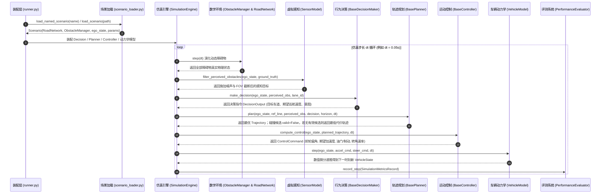

# 智能车辆仿真系统：全栈架构规范、变量量纲口径与 AI 协作开发指南
### Intelligent Vehicle Simulation System: Architecture, Conventions, and AI Collaboration Specification

> **版本**：v0.3（2026-10-19）。本版在 v0.2 闭环基线上补齐 **EM/QP 规划器、LTV-MPC 控制器、Pacejka 轮胎主回路** 与**纯 NumPy QP 后端**，并把“未实现接口必须显式失败”的规则收窄到 INTERACTION/NGSIM、全量生产标定、OpenSCENARIO 等仍未完成项。v0.2 的 P0 基线为 commit `e701687`。

> **说明文档定位**：本规范文件为本项目（中国仿真创新应用大赛参赛作品）的**单一真实数据源（Single Source of Truth, SSOT）**。旨在统一整个系统内部的所有数学物理坐标系、状态变量命名口径、量纲单位及模块间交互契约。
> 
> **面向对象**：后续维护本项目的开发者、评审专家，以及**接入本代码库进行迭代开发、算法补全与重构的 AI 编程助手（如 Gemini、Claude、Cursor、Copilot、ChatGPT 等）**。任何后续 AI 或工程师在修改/新增代码前，**必须严格遵循本规范中定义的命名法则与接口契约**。

---

## 目录
- [一、 国际标准与物理坐标系规范](#一-国际标准与物理坐标系规范)
- [二、 变量命名口径与物理量纲字典 (Data Dictionary)](#二-变量命名口径与物理量纲字典-data-dictionary)
- [三、 核心模块数据流与调用拓扑 (Dataflow & Topology)](#三-核心模块数据流与调用拓扑-dataflow--topology)
- [四、 模块职责边界与修改扩展契约 (Invariants & Extension Contracts)](#四-模块职责边界与修改扩展契约-invariants--extension-contracts)
- [五、 后续 AI 工具修改代码操作守则 (AI Prompt & Development Rules)](#五-后续-ai-工具修改代码操作守则-ai-prompt--development-rules)
- [六、 当前实现边界与验收口径（v0.2）](#六-当前实现边界与验收口径v02)

---

## 一、 国际标准与物理坐标系规范

系统中所有运动学、动力学以及几何空间运算，严格遵从智能车辆工程主流国际标准：

### 1. 车辆机体坐标系 (Vehicle Coordinate System)
- **遵循标准**：**ISO 8855 / SAE J670** 车辆动力学坐标系；
- **原点**：车辆后轴中心点（运动学自行车模型）或车辆质心点（二自由度动力学模型）；
- **v0.3 实现口径**：`KinematicBicycleModel` 以**后轴中心**为位姿参考点；`DynamicBicycleModel` 以**质心**为位姿参考点。`SimulationEngine` 通过 `use_dynamic_model` 切换模型时**没有做后轴/质心原点平移**，因此跨模型对比实验必须固定同一模型，或先显式做原点变换。`DynamicBicycleModel` 的 `tire_model` 可取 `linear` 或 `pacejka`；选择 `pacejka` 时 `SimulationEngine` 自动启用动力学模型。
- **X 轴**：沿车身纵轴指向正前方，前向为正；
- **Y 轴**：垂直于车身纵轴指向左侧，左侧为正；
- **Z 轴**：垂直于地面指向天空，天向为正（右手系）；
- **航向角 ($\psi$, Heading/Yaw)**：车身纵轴与世界全局大地坐标系 X 轴的夹角，逆时针方向（向左偏转）为正，范围严格归一化为 $[-\pi, \pi]$。

### 2. 世界全局坐标系 (Global Cartesian Coordinate System)
- 二维平面右手笛卡尔坐标系 $(X, Y)$；
- 车辆全局位置由质心或后轴中心在大地平面投影坐标 $(x, y)$ 确定，单位均为米（$\text{m}$）。

### 3. 道路参考线时空坐标系 (Frenet Frame)
- **参考线 (Reference Line)**：光滑连续可微的二维曲线 $\mathbf{r}(s) = (x_r(s), y_r(s))$；
- **v0.2 实现口径**：`RoadNetwork` 实际使用车道中心**折线**（默认 1 m 重采样）计算累积弧长、切向角与曲率，属于分段线性近似；`FrenetConverter.ref_point_at_s` 做线性插值。若需要解析光滑参考线，应接入样条/优化平滑器。
- **纵向坐标 $s$ (Station)**：沿道路参考线中心线的累积曲线弧长，前进方向为正，单位 $\text{m}$；
- **横向偏离 $l$ (Lateral Offset)**：自车位置到参考线上正交投影点（Footpoint）的有向垂直距离，**位于参考线左侧为正，右侧为负**，单位 $\text{m}$；
- **导数严格区分**：
  - 对时间的一阶/二阶导数：记作 $\dot{s}$ ($\text{m/s}$), $\ddot{s}$ ($\text{m/s}^2$), $\dot{l}$ ($\text{m/s}$), $\ddot{l}$ ($\text{m/s}^2$)；
  - 对弧长 $s$ 的几何导数：记作 $l' = \frac{dl}{ds}$ (无量纲), $l'' = \frac{d^2l}{ds^2}$ ($\text{m}^{-1}$)。

---

## 二、 变量命名口径与物理量纲字典 (Data Dictionary)

所有类属性、函数参数、局部计算变量与持久化数据，**一律使用国际单位制 (SI Units)**。严禁在核心算法内部混合使用 $\text{km/h}$、角度制等非标准量纲（仅在可视化 HUD 文本显示时允许转换为 $\text{km/h}$）。

> **接口/遥测例外（v0.2）**：
> - 传感器配置中的 FOV 允许以度（`fov_deg`）传入，但 `SensorModel` 构造后立即转换为 `fov_rad`，核心感知逻辑只用弧度；
> - KPI/遥测字段 `*_latency_ms` 以毫秒记录，便于工程阅读，不参与控制律计算；如需 SI，请在使用前除以 1000；
> - 除上述两处外，核心算法、状态量与轨迹量一律使用 m / m·s⁻¹ / m·s⁻² / rad / rad·s⁻¹。

### 1. 车辆物理状态变量 (`VehicleState`)
| 变量名 | Python 类型 | 物理量纲 (单位) | 详细物理含义与口径说明 |
| :--- | :--- | :--- | :--- |
| `x` | `float` | $\text{m}$ | 全局笛卡尔坐标系 X 坐标 |
| `y` | `float` | $\text{m}$ | 全局笛卡尔坐标系 Y 坐标 |
| `heading` | `float` | $\text{rad}$ | 车身全局航向角 $\psi$，逆时针为正，范围 $[-\pi, \pi]$ |
| `velocity` | `float` | $\text{m/s}$ | 车身合速度标量 $v = \sqrt{v_x^2 + v_y^2} \ge 0$ |
| `vx` | `float` | $\text{m/s}$ | 车身纵向坐标轴分速度（前进为正） |
| `vy` | `float` | $\text{m/s}$ | 车身横向坐标轴侧滑分速度（向左为正） |
| `acceleration` | `float` | $\text{m/s}^2$ | 标量合加速度 |
| `ax` | `float` | $\text{m/s}^2$ | 纵向切向加速度（驱动为正，制动为负） |
| `ay` | `float` | $\text{m/s}^2$ | 横向向心/侧向加速度 $a_y = \dot{v}_y + v_x r$ |
| `yaw_rate` | `float` | $\text{rad/s}$ | 绕 Z 轴横摆角速度 $r = \dot{\psi}$ |
| `steer_angle` | `float` | $\text{rad}$ | 前轮偏角 $\delta$，向左打舵为正，向右为负 |
| `timestamp` | `float` | $\text{s}$ | 仿真时基时间戳，单调自增 |

### 2. 轨迹离散时空点变量 (`TrajectoryPoint`)
| 变量名 | Python 类型 | 物理量纲 (单位) | 详细含义说明 |
| :--- | :--- | :--- | :--- |
| `x`, `y` | `float` | $\text{m}$ | 规划期望全局空间坐标 |
| `theta` | `float` | $\text{rad}$ | 轨迹切线朝向方位角 |
| `kappa` | `float` | $\text{m}^{-1}$ | 曲线瞬时曲率 $\kappa = \frac{d\theta}{ds}$ |
| `dkappa` | `float` | $\text{m}^{-2}$ | 曲率对弧长的变化率 $d\kappa/ds$ |
| `v` | `float` | $\text{m/s}$ | 期望瞬时线速度 |
| `a` | `float` | $\text{m/s}^2$ | 期望切向加速度 |
| `jerk` | `float` | $\text{m/s}^3$ | 加加速度 $\dot{a}$，用于衡量舒适性 |
| `t` | `float` | $\text{s}$ | 相对规划起点的到达时间；v0.2 统一使用相对时间 |
| `s` | `float` | $\text{m}$ | 沿参考线的纵向弧长（v0.2 直接使用 Frenet $s$；大横向偏移时与实际路径弧长有差异） |

### 3. Frenet 时空坐标状态变量 (`FrenetPoint`)
| 变量名 | Python 类型 | 物理量纲 (单位) | 详细含义说明 |
| :--- | :--- | :--- | :--- |
| `s` | `float` | $\text{m}$ | 沿参考线的纵向累积弧长 |
| `s_d` | `float` | $\text{m/s}$ | 纵向线速度 $\dot{s} = ds/dt$ |
| `s_dd` | `float` | $\text{m/s}^2$ | 纵向加速度 $\ddot{s} = d^2s/dt^2$ |
| `s_ddd` | `float` | $\text{m/s}^3$ | 纵向加加速度 $\dddot{s} = d^3s/dt^3$ |
| `l` | `float` | $\text{m}$ | 横向偏离量（左正右负） |
| `l_d` | `float` | $\text{m/s}$ | 横向相对速度 $\dot{l} = dl/dt$ |
| `l_dd` | `float` | $\text{m/s}^2$ | 横向相对加速度 $\ddot{l} = d^2l/dt^2$ |
| `l_prime` | `float` | 无量纲 | 横向对弧长的一阶导 $l' = dl/ds$ |
| `l_prime_prime` | `float` | $\text{m}^{-1}$ | 横向对弧长的二阶导 $l'' = d^2l/ds^2$ |

> **v0.2 实现说明**：`cartesian_to_frenet` 目前把 `l_prime_prime` 置 0，`s_dd` 用 $a_x\cos\Delta\theta$ 近似，`frenet_to_cartesian` 的解析曲率因此只是近似；`FrenetLatticePlanner` 在生成离散点后会用 $\theta(s)$ 差分重新填充 `kappa/dkappa`。高精度曲率需要补全 $l''$ 解析式或改用样条。

### 4. 执行控制输出量 (`ControlCommand`)
| 变量名 | 物理量纲 | 物理范围限制 | 说明 |
| :--- | :--- | :--- | :--- |
| `steering_angle` | $\text{rad}$ | $[-\delta_{max}, \delta_{max}]$ (约 $\pm 0.65\,\text{rad}$) | 底层转向机构前轮偏角 |
| `acceleration` | $\text{m/s}^2$ | $[-a_{decel\_max}, a_{accel\_max}]$ | 底层驱动/制动目标加速度 |
| `throttle` | 无量纲 | $[0.0, 1.0]$ | 油门踏板开度百分比 |
| `brake` | 无量纲 | $[0.0, 1.0]$ | 制动踏板开度百分比 |
| `steering_rate` | $\text{rad/s}$ | 由 `max_steer_rate` 限制 | 前轮转角变化率，用于执行机构速率约束 |

### 5. 障碍物状态 (`ObstacleState`)

| 变量名 | 类型 | 单位 | 说明 |
| :--- | :--- | :--- | :--- |
| `id` | `str` | — | 障碍物唯一标识 |
| `obstacle_type` | `ObstacleType` | — | CAR / TRUCK / PEDESTRIAN / BICYCLE / STATIC |
| `x`, `y` | `float` | $\text{m}$ | 几何中心全局坐标 |
| `length`, `width` | `float` | $\text{m}$ | OBB 尺寸 |
| `heading` | `float` | $\text{rad}$ | OBB 朝向 |
| `vx`, `vy` | `float` | $\text{m/s}$ | 全局速度分量 |
| `predicted_trajectory` | `Optional[List[TrajectoryPoint]]` | — | 未来预测轨迹，点 `t` 为相对预测时刻 |

### 6. 参考线点 (`ReferencePoint`)

| 变量名 | 类型 | 单位 | 说明 |
| :--- | :--- | :--- | :--- |
| `x`, `y` | `float` | $\text{m}$ | 参考线全局坐标 |
| `theta` | `float` | $\text{rad}$ | 切线方位角 |
| `kappa` | `float` | $\text{m}^{-1}$ | 曲率 |
| `dkappa` | `float` | $\text{m}^{-2}$ | 曲率对弧长的变化率 |
| `s` | `float` | $\text{m}$ | 累积弧长 |

### 7. 决策输出 (`DecisionOutput`)

| 变量名 | 类型 | 单位 | 说明 |
| :--- | :--- | :--- | :--- |
| `intent` | `DrivingIntent` | — | CRUISE / FOLLOW / MERGE / YIELD / EMERGENCY_STOP 等 |
| `target_lane_id` | `str` | — | 目标车道 ID |
| `target_speed` | `float` | $\text{m/s}$ | 期望巡航/跟驰速度 |
| `time_headway` | `float` | $\text{s}$ | 期望车头时距 |
| `lead_obstacle_id` | `Optional[str]` | — | 关键前导车 ID |
| `lateral_shift_l` | `float` | $\text{m}$ | 相对目标参考线的横向偏移目标 |
| `reasoning_log` | `str` | — | 决策解释链 |

> 决策层仍**禁止**直接输出 `steering_angle`、`throttle`、`brake` 等底层执行量。

### 8. 轨迹容器 (`Trajectory`)

| 变量名 | 类型 | 说明 |
| :--- | :--- | :--- |
| `points` | `List[TrajectoryPoint]` | 按 `t` 递增排列的轨迹点 |
| `total_cost` | `float` | 综合代价值，越小越优 |
| `valid` | `bool` | 是否通过碰撞/动力学约束；`False` 表示无有效候选时的兜底轨迹 |

---

## 三、 核心模块数据流与调用拓扑 (Dataflow & Topology)



---

## 四、 模块职责边界与修改扩展契约 (Invariants & Extension Contracts)

后续开发或 AI 助手在修改具体模块时，**必须保持以下不变量（Invariants）与职责隔离**：

### 1. `src/common/` (基础层)
- **职责**：纯数学与纯数据类，**绝对不允许引用** `decision`、`planning`、`control` 等业务逻辑模块；
- **契约**：纯数据容器（`VehicleState` / `TrajectoryPoint` / `FrenetPoint` / `ObstacleState` / `ReferencePoint`）统一使用 Python `@dataclass`；几何/碰撞类（`Point2D` / `BoundingBox2D`）允许使用普通类，但字段、单位与构造参数必须有清晰注释。

### 2. `src/environment/` (环境层)
- **职责**：管理道路几何拓扑（`RoadNetwork`）、场景装载（`scenario_loader.py`）、真实交通数据集解析（`BaseDatasetLoader`）、交通流参数辨识（`calibration.py`）与多车动态微观演化（`ObstacleManager`）；
- **当前实现**：IDM 跟驰已进入 `ObstacleManager.step()`，背景车预测使用最近一次计算的纵向加速度作恒加速度外推并在零速处停止；MOBIL 换道状态机已接入 `ObstacleManager`（通过场景 `traffic.enable_mobil` 配置开启，支持平滑三次多项式横向过渡）；场景障碍物还支持按配置时间启动的脚本化平滑换道；highD 格式 CSV 解析器已实现（`HighDDatasetLoader`），并配套微型演示切片生成器（`scripts/generate_sample_highd.py`）与系统辨识工具链（`src/environment/calibration.py`）；INTERACTION/NGSIM 仍为接口骨架。
- **扩展规范**：若新增数据集解析器（如 Waymo 或 nuScenes），必须继承 `BaseDatasetLoader` 并实现 `load_scenario()` 与 `get_frame_obstacles()`。

### 3. `src/vehicle_model/` (物理机理层)
- **职责**：智能车辆物理与数字孪生计算；
- **动力学模型约束**：输入必须是 `(state, accel_cmd, steer_cmd, dt)`，输出必须是步进更新后的 `VehicleState`；严禁在动力学模型内部处理决策或路径搜索逻辑。
- **轮胎模型契约**：`DynamicBicycleModel(tire_model="linear"|"pacejka")`。`linear` 分支保持原有公式与积分顺序；`pacejka` 分支使用 `PacejkaTireModel.lateral_force/combined_lateral_force`，并显式计算前/后轴载荷转移。`pacejka_tire_model()` 仅作为兼容接口保留。
- **边界**：Pacejka 为稳态纯侧偏 + 简化摩擦椭圆，不包含松弛长度、温度/胎压与完整试验标定。

### 4. `src/decision/` (行为决策层)
- **职责**：宏观战略意图判定，输出高层指令 `DecisionOutput`；
- **禁止项**：决策层**禁止直接输出底层转向角、油门/制动或方向盘扭矩**；
- **允许输出**：`intent`（巡航、跟驰、换道、停车等）、`target_lane_id`、`target_speed`、`time_headway`、`lead_obstacle_id`、`lateral_shift_l` 与 `reasoning_log`。

### 5. `src/planning/` (局部轨迹规划层)
- **职责**：在决策约束与参考线指引下，解算连续平滑时空轨迹；
- **输入输出契约**：
  - 输入：`ego_state`, `reference_line`, `obstacles`, `decision`, `horizon`, `dt`；
  - 输出：`Trajectory`（由若干按时间递增排列的 `TrajectoryPoint` 组成）；
- **平滑性要求（验收目标）**：轨迹应尽量保证曲率 $\kappa$ 连续、加速度 $a$ 在物理极限以内；
- **v0.2 实现**：`FrenetLatticePlanner` 用五次多项式生成候选，`kappa/dkappa` 由离散 $\theta(s)$ 差分计算；通过横向加速度代价、加速度越界 `valid=False` 与 OBB 碰撞校验进行约束，属于**软约束 + 候选筛选**，不是数学上的硬保证。若无任何无碰撞候选，返回综合代价最低的轨迹并置 `valid=False`，控制器仍会执行制动/跟踪。
- **v0.3 新增 EM/QP**：`EMPlanner` 执行“路径 QP + 速度 QP”的路径-速度解耦。路径 QP 优化 `l(s)`（道路边界、起点位姿、障碍物单侧凸走廊，带松弛）；速度 QP 优化 `v(t)`（速度/加速度/加加速度边界、S-T 图跟驰/停车上界）。终端速度保护用于避免时域截断后追尾。QP 失败时分别退化为 smoothstep 横移与带制动距离约束的速度剖面，且仍执行 OBB 碰撞校验。
- **边界**：不是 Apollo EM 的完整迭代 E/M 收敛；动态障碍物走廊采用当前/预测轨迹的单侧凸近似。

### 6. `src/control/` (运动控制层)
- **职责**：跟踪规划轨迹，抑制扰动；
- **输入输出契约**：根据当前 `VehicleState` 与 `Trajectory`，计算出 `ControlCommand`（转向角、期望加速度、油门/制动开度、转角速率）。
- **当前实现**：`LQRController` 使用时间索引预瞄 + 曲率前馈 + 横向加速度/转角速率限制；纵向复用 `LongitudinalPIDController`，并对目标速度做一阶低通、对加速度做 jerk 限制。
- **v0.3 新增 LTV-MPC**：`MPCController` 以 `[e_y, e_psi, e_v]` 误差状态和 `[a, delta]` 控制量构建预测 QP，约束含执行机构硬边界、jerk/转角速率硬约束与横向软约束（slack）。QP 由 `src/common/qp.py` 求解；失败时回退为曲率前馈 PD + 纵向 P，并在 `last_solve_info` 记录诊断。
- **边界**：不是非线性 NMPC；预测模型不包含 Pacejka 轮胎动力学。

### 7. `src/runner.py` (装配层)
- **职责**：把 `Scenario` 装配为 `SimulationEngine`，统一读取车辆参数、传感器参数、决策器/规划器/控制器/轮胎模型；
- **算法选择**：`build_planner(scenario, planner="lattice"|"em")`、`build_controller(scenario, controller="lqr"|"mpc")`、`build_engine(..., tire_model="linear"|"pacejka")`；优先级为显式参数 > 场景配置 > 默认值；
- **禁止项**：装配层不得包含决策、规划或控制算法逻辑，也不得硬编码与场景 YAML 不一致的世界参数。

### 8. `src/common/qp.py` (优化后端)
- **职责**：为 MPC 与 EM 提供统一的稠密凸 QP 求解；
- **形式**：`min 0.5 x'Px + q'x s.t. l <= Ax <= u, lb <= x <= ub`；
- **实现**：纯 NumPy ADMM（OSQP 风格，支持过松弛、自适应 rho、热启动）；
- **契约**：调用方必须检查 `QPSolution.success` 与 `constraint_violation`；未收敛解不得被表述为硬约束保证；
- **边界**：不承诺硬实时；`max_planning_latency_ms` 必须在目标机器实测。

---

## 五、 后续 AI 工具修改代码操作守则 (AI Prompt & Development Rules)

若您是使用其他 AI 软件（如 Claude, Cursor, Copilot 等）进行辅助修改，请将以下守则作为系统 Prompt 的一部分传递给 AI：

```markdown
### AI 辅助开发准则：
1. 【量纲一致性】：所有代码中的空间长度必须为米(m)，速度为米/秒(m/s)，时间为秒(s)，角速度为弧度/秒(rad/s)，绝对禁止随意引入非国际标准量纲。
2. 【接口继承】：修改或新增规划算法时，必须继承 src.planning.base_planner.BasePlanner；修改决策算法必须继承 src.decision.base_decision.BaseDecisionMaker。
3. 【坐标变换】：任何需要完整 Frenet 状态 (s, l, s_d, l_d, l', ...) 的笛卡尔→参考线映射，必须统一调用 src.common.frenet_frame.FrenetConverter；严禁在各算法内部重复编写易出错的完整旋转/投影方程。**例外**：车道归属查询、同车道前后车筛选可使用 RoadNetwork 的车道中心几何，但不得据此替代 Frenet 状态转换。
4. 【单元测试先行】：每新增或深度重构一个核心类，必须在 tests/ 目录下补充对应的 unittest 单元测试，确保运行 `python3 -m unittest discover tests` 100% 通过；当前测试数量以实际运行输出为准。低功耗环境下建议限制 BLAS 线程并使用 `nice`。
5. 【文档同步更新】：若对核心参数、类接口做了增删，必须同步更新 docs/ 下对应的大赛技术支撑报告。
6. 【未实现接口必须显式失败】：INTERACTION/NGSIM 数据接入、OpenSCENARIO/ROS/CARLA 联合仿真等尚未实现的入口必须抛出 NotImplementedError 或返回明确的“不支持”状态，禁止返回空 Trajectory / 零控制量冒充有效输出。EM/QP 与 MPC 已实现，失败时必须返回可诊断的回退结果（`last_path_result` / `last_speed_result` / `last_solve_info`），不得静默伪装成功。
7. 【结果由脚本生成】：KPI 表、曲线与对比数字必须由 scripts/ 下的运行/评测脚本生成；单 seed 结果必须标注，禁止手填或复制旧文档数字。
```


---

## 六、 当前实现边界与验收口径（v0.3）

> 本节用于防止“接口预留”被写成“已完成”。修改代码或文档前，先对照下表。

### 1. 已进入闭环的模块

| 模块 | 入口 | 验收方式 |
| :--- | :--- | :--- |
| 场景加载 | `src/environment/scenario_loader.py` | YAML/JSON -> `Scenario`；内置 `highway_merge`、`emergency_avoidance`、`cut_in` |
| 道路参考线 | `src/environment/road_network.py` | 生成真实 `s/theta/kappa`，按位置查车道 |
| Frenet 映射 | `src/common/frenet_frame.py` | 正交投影 + `ref_point_at_s` 插值；`l_prime_prime` 暂置 0，规划器数值重算曲率 |
| 轨迹规划 | `src/planning/frenet_lattice.py` | 五次多项式 + 时间投影 OBB 碰撞校验 + 曲率/jerk 填充 |
| 行为决策 | `src/decision/rule_based_fsm.py` / `game_theoretic.py` | 跟驰、汇入、紧急停车；2×2 收益矩阵 |
| 横向控制 | `src/control/lqr_controller.py` | 时间索引预瞄 + 曲率前馈 + 横向加速度限制 |
| LTV-MPC | `src/control/mpc_controller.py` | 误差动力学 + QP 硬/软约束 + 回退诊断 |
| 纵向控制 | `src/control/pid_controller.py` | 测量值微分 + 抗积分饱和 |
| EM/QP 规划 | `src/planning/em_planner.py` | 路径 QP + ST 速度 QP + 终端速度保护 |
| QP 后端 | `src/common/qp.py` | 纯 NumPy ADMM + 热启动 + 残差诊断 |
| 车辆模型 | `src/vehicle_model/kinematics.py` / `dynamics.py` | 运动学 / 2-DOF 线性或 Pacejka 轮胎 |
| Pacejka 轮胎 | `src/vehicle_model/tire.py` | 稳态魔术公式 + 载荷转移 + 简化摩擦椭圆 |
| 交通演化与换道 | `src/environment/obstacle_manager.py` | IDM 跟驰 + 加速度外推；MOBIL 换道状态机（支持平滑三次多项式过渡） |
| 数据集解析与演示 | `src/environment/dataset_loader.py` | highD 格式 CSV 解析；微型演示切片 `scripts/generate_sample_highd.py` |
| 参数标定工具链 | `src/environment/calibration.py` | 基于非线性优化的 IDM 跟驰参数系统辨识 |
| KPI | `src/simulator.py` / `src/evaluation/metrics.py` | 碰撞、OBB 净距、TTC、横向/航向误差、Δa/Δt jerk、时延拆分 |
| 批量评测 | `src/evaluation/benchmark.py` | 多 seed × 多决策 × 多场景 × planner/controller/tire；JSON 保留配置、逐次结果和分组汇总，CSV 分别输出原始运行与分组统计 |

### 2. 仅接口预留 / 未实现

| 功能 | 现状 | 禁止表述 |
| :--- | :--- | :--- |
| INTERACTION / NGSIM | 接口骨架，返回元数据/空列表 | “已接入 INTERACTION/NGSIM” |
| 全量实测数据生产标定 | 具备标定工具链与微型演示切片；仓库未附带数十 GB 全量数据 | “已用全量实车数据完成生产标定” |
| OpenSCENARIO / ROS / CARLA | 占位函数或规划 | “已支持联合仿真” |
| 大规模多 seed 统计 | 当前仅单 seed/短时冒烟 | “统计显著优于基线” |

### 3. 指标口径

- **碰撞**：OBB + SAT，`buffer=0`；任一步相交即 `is_collision=True`。
- **最小净距**：矩形边界最短距离，不是中心点距离。
- **TTC**：仅前方、横向重叠目标，`gap / closing_speed`；无接近目标记 999。
- **Jerk**：实际加速度差分 `Δa/Δt`，不是轨迹理论值。
- **横向误差**：自车到规划轨迹最近点的 cross-track 误差。
- **时延**：决策、规划、控制分别计时，禁止合并成一个 `planning_latency_ms`。
- **QP 诊断与回退**：MPC 用 `last_solve_info`（status/success/iterations/residual/violation），EM 用 `last_path_result` / `last_speed_result`（success/iterations/constraint_violation/note）记录求解质量；`planner_fallback` 由 EM 路径/速度 QP 成功标志判定（任一失败或空轨迹置 True；Lattice 恒为 False）；`controller_fallback` 由 MPC QP 成功标志判定（失败或空轨迹置 True；LQR 恒为 False）；汇总报告回退次数与比率。
- **P95 时延**：`p95_planning_latency_ms` 与 `p95_control_latency_ms` 仅在有效仿真帧数 $\ge 20$ 时输出，避免微型测试产生失真分位数。
- **碰撞计数**：`collision_count` 为逐帧碰撞障碍物数量之和；`collision_frames` 为发生碰撞的帧数；单次 `success_rate` 是 0/1 结果。批量汇总中的 `success_rate_mean` 是逐次二值结果的均值，并给出 Wilson 95% 区间；其他数值指标报告均值与样本标准差（单样本标准差记 0）。
- **长度口径**：`TrajectoryPoint.s` 是参考线站距，不是实际路径弧长；大横向偏移时两者有差异。

### 4. 结果可信度

- 结果表必须由 `scripts/run_benchmark.py` 或 `scripts/run_simulation.py --save_results` 生成；批量基准写出 `benchmark.json`、原始运行 `benchmark.csv` 和分组 `benchmark_summary.csv`；
- 至少报告 seed、场景、时长、样本数；单 seed 结果不得写成统计结论；
- 早期文档中的 99.2%、4.6 m、0.86 m/s³、12.5 ms 等数字已无代码依据，禁止再次引用。
- EM/QP、MPC、Pacejka 的短时冒烟结果不得写成“统计显著优于 LQR/Lattice”；单 seed 表只描述该次运行。
