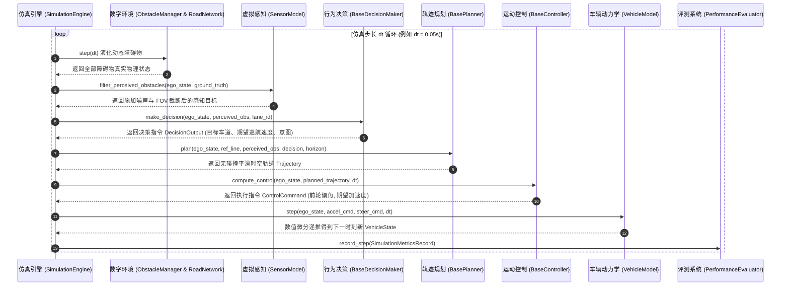

# 智能车辆仿真系统：全栈架构规范、变量量纲口径与 AI 协作开发指南
### Intelligent Vehicle Simulation System: Architecture, Conventions, and AI Collaboration Specification

> **说明文档定位**：本规范文件为本项目（中国仿真创新应用大赛参赛作品）的**单一真实数据源（Single Source of Truth, SSOT）**。旨在统一整个系统内部的所有数学物理坐标系、状态变量命名口径、量纲单位及模块间交互契约。
> 
> **面向对象**：后续维护本项目的开发者、评审专家，以及**接入本代码库进行迭代开发、算法补全与重构的 AI 编程助手（如 Gemini、Claude、Cursor、Copilot、ChatGPT 等）**。任何后续 AI 或工程师在修改/新增代码前，**必须严格遵循本规范中定义的命名法则与接口契约**。

---

## 目录
- [一、 国际标准与物理坐标系规范](#一-国际标准与物理坐标系规范)
- [二、 变量命名口径与物理量纲字典 (Data Dictionary)](#二-变量命名口径与物理量纲字典-data-dictionary)
- [三、 核心模块数据流与调用拓扑 (Dataflow & Topology)](#三-核心模块数据流与调用拓扑-dataflow--topology)
- [四、 模块职责边界与修改扩展契约 (Invariants & Extension Contracts)](#四-模块职责边界与修改扩展契约-invariants--extension-contracts)
- [五、 后续 AI 工具修改代码操作守则 (AI Prompt & Development Rules)](#五-后续-ai-工具修改代码操作守则-ai-prompt--development-rules)

---

## 一、 国际标准与物理坐标系规范

系统中所有运动学、动力学以及几何空间运算，严格遵从智能车辆工程主流国际标准：

### 1. 车辆机体坐标系 (Vehicle Coordinate System)
- **遵循标准**：**ISO 8855 / SAE J670** 车辆动力学坐标系；
- **原点**：车辆后轴中心点（运动学自行车模型）或车辆质心点（二自由度动力学模型）；
- **X 轴**：沿车身纵轴指向正前方，前向为正；
- **Y 轴**：垂直于车身纵轴指向左侧，左侧为正；
- **Z 轴**：垂直于地面指向天空，天向为正（右手系）；
- **航向角 ($\psi$, Heading/Yaw)**：车身纵轴与世界全局大地坐标系 X 轴的夹角，逆时针方向（向左偏转）为正，范围严格归一化为 $[-\pi, \pi]$。

### 2. 世界全局坐标系 (Global Cartesian Coordinate System)
- 二维平面右手笛卡尔坐标系 $(X, Y)$；
- 车辆全局位置由质心或后轴中心在大地平面投影坐标 $(x, y)$ 确定，单位均为米（$\text{m}$）。

### 3. 道路参考线时空坐标系 (Frenet Frame)
- **参考线 (Reference Line)**：光滑连续可微的二维曲线 $\mathbf{r}(s) = (x_r(s), y_r(s))$；
- **纵向坐标 $s$ (Station)**：沿道路参考线中心线的累积曲线弧长，前进方向为正，单位 $\text{m}$；
- **横向偏离 $l$ (Lateral Offset)**：自车位置到参考线上正交投影点（Footpoint）的有向垂直距离，**位于参考线左侧为正，右侧为负**，单位 $\text{m}$；
- **导数严格区分**：
  - 对时间的一阶/二阶导数：记作 $\dot{s}$ ($\text{m/s}$), $\ddot{s}$ ($\text{m/s}^2$), $\dot{l}$ ($\text{m/s}$), $\ddot{l}$ ($\text{m/s}^2$)；
  - 对弧长 $s$ 的几何导数：记作 $l' = \frac{dl}{ds}$ (无量纲), $l'' = \frac{d^2l}{ds^2}$ ($\text{m}^{-1}$)。

---

## 二、 变量命名口径与物理量纲字典 (Data Dictionary)

所有类属性、函数参数、局部计算变量与持久化数据，**一律使用国际单位制 (SI Units)**。严禁在核心算法内部混合使用 $\text{km/h}$、角度制等非标准量纲（仅在可视化 HUD 文本显示时允许转换为 $\text{km/h}$）。

### 1. 车辆物理状态变量 (`VehicleState`)
| 变量名 | Python 类型 | 物理量纲 (单位) | 详细物理含义与口径说明 |
| :--- | :--- | :--- | :--- |
| `x` | `float` | $\text{m}$ | 全局笛卡尔坐标系 X 坐标 |
| `y` | `float` | $\text{m}$ | 全局笛卡尔坐标系 Y 坐标 |
| `heading` | `float` | $\text{rad}$ | 车身全局航向角 $\psi$，逆时针为正，范围 $[-\pi, \pi]$ |
| `velocity` | `float` | $\text{m/s}$ | 车身合速度标量 $v = \sqrt{v_x^2 + v_y^2} \ge 0$ |
| `vx` | `float` | $\text{m/s}$ | 车身纵向坐标轴分速度（前进为正） |
| `vy` | `float` | $\text{m/s}$ | 车身横向坐标轴侧滑分速度（向左为正） |
| `acceleration` | `float` | $\text{m/s}^2$ | 标量合加速度 |
| `ax` | `float` | $\text{m/s}^2$ | 纵向切向加速度（驱动为正，制动为负） |
| `ay` | `float` | $\text{m/s}^2$ | 横向向心/侧向加速度 $a_y = \dot{v}_y + v_x r$ |
| `yaw_rate` | `float` | $\text{rad/s}$ | 绕 Z 轴横摆角速度 $r = \dot{\psi}$ |
| `steer_angle` | `float` | $\text{rad}$ | 前轮偏角 $\delta$，向左打舵为正，向右为负 |
| `timestamp` | `float` | $\text{s}$ | 仿真时基时间戳，单调自增 |

### 2. 轨迹离散时空点变量 (`TrajectoryPoint`)
| 变量名 | Python 类型 | 物理量纲 (单位) | 详细含义说明 |
| :--- | :--- | :--- | :--- |
| `x`, `y` | `float` | $\text{m}$ | 规划期望全局空间坐标 |
| `theta` | `float` | $\text{rad}$ | 轨迹切线朝向方位角 |
| `kappa` | `float` | $\text{m}^{-1}$ | 曲线瞬时曲率 $\kappa = \frac{d\theta}{ds}$ |
| `dkappa` | `float` | $\text{m}^{-2}$ | 曲率对弧长的变化率 $d\kappa/ds$ |
| `v` | `float` | $\text{m/s}$ | 期望瞬时线速度 |
| `a` | `float` | $\text{m/s}^2$ | 期望切向加速度 |
| `jerk` | `float` | $\text{m/s}^3$ | 加加速度 $\dot{a}$，用于衡量舒适性 |
| `t` | `float` | $\text{s}$ | 规划轨迹时序相对到达时间或绝对时间戳 |
| `s` | `float` | $\text{m}$ | 沿规划路径的累积弧长 |

### 3. Frenet 时空坐标状态变量 (`FrenetPoint`)
| 变量名 | Python 类型 | 物理量纲 (单位) | 详细含义说明 |
| :--- | :--- | :--- | :--- |
| `s` | `float` | $\text{m}$ | 沿参考线的纵向累积弧长 |
| `s_d` | `float` | $\text{m/s}$ | 纵向线速度 $\dot{s} = ds/dt$ |
| `s_dd` | `float` | $\text{m/s}^2$ | 纵向加速度 $\ddot{s} = d^2s/dt^2$ |
| `s_ddd` | `float` | $\text{m/s}^3$ | 纵向加加速度 $\dddot{s} = d^3s/dt^3$ |
| `l` | `float` | $\text{m}$ | 横向偏离量（左正右负） |
| `l_d` | `float` | $\text{m/s}$ | 横向相对速度 $\dot{l} = dl/dt$ |
| `l_dd` | `float` | $\text{m/s}^2$ | 横向相对加速度 $\ddot{l} = d^2l/dt^2$ |
| `l_prime` | `float` | 无量纲 | 横向对弧长的一阶导 $l' = dl/ds$ |
| `l_prime_prime` | `float` | $\text{m}^{-1}$ | 横向对弧长的二阶导 $l'' = d^2l/ds^2$ |

### 4. 执行控制输出量 (`ControlCommand`)
| 变量名 | 物理量纲 | 物理范围限制 | 说明 |
| :--- | :--- | :--- | :--- |
| `steering_angle` | $\text{rad}$ | $[-\delta_{max}, \delta_{max}]$ (约 $\pm 0.65\,\text{rad}$) | 底层转向机构前轮偏角 |
| `acceleration` | $\text{m/s}^2$ | $[-a_{decel\_max}, a_{accel\_max}]$ | 底层驱动/制动目标加速度 |
| `throttle` | 无量纲 | $[0.0, 1.0]$ | 油门踏板开度百分比 |
| `brake` | 无量纲 | $[0.0, 1.0]$ | 制动踏板开度百分比 |

---

## 三、 核心模块数据流与调用拓扑 (Dataflow & Topology)



---

## 四、 模块职责边界与修改扩展契约 (Invariants & Extension Contracts)

后续开发或 AI 助手在修改具体模块时，**必须保持以下不变量（Invariants）与职责隔离**：

### 1. `src/common/` (基础层)
- **职责**：纯数学与纯数据类，**绝对不允许引用** `decision`、`planning`、`control` 等业务逻辑模块；
- **契约**：所有数据类统一使用 Python `@dataclass` 装饰器，必须提供明确的默认值与清晰字段注释。

### 2. `src/environment/` (环境层)
- **职责**：管理道路几何拓扑（`RoadNetwork`）、真实交通数据集解析（`BaseDatasetLoader`）与多车动态微观跟驰换道演化（`ObstacleManager`）；
- **扩展规范**：若新增数据集解析器（如 Waymo 或 nuScenes），必须继承 `BaseDatasetLoader` 并实现 `load_scenario()` 与 `get_frame_obstacles()`。

### 3. `src/vehicle_model/` (物理机理层)
- **职责**：智能车辆物理与数字孪生计算；
- **动力学模型约束**：输入必须是 `(state, accel_cmd, steer_cmd, dt)`，输出必须是步进更新后的 `VehicleState`；严禁在动力学模型内部处理决策或路径搜索逻辑。

### 4. `src/decision/` (行为决策层)
- **职责**：宏观战略意图判定，输出高层指令 `DecisionOutput`；
- **禁止项**：决策层**禁止直接输出底层转向角或方向盘扭矩**，其输出只能包括 `intent`（巡航、跟驰、换道、停车）、`target_lane_id`、`target_speed` 与安全走廊边界约束。

### 5. `src/planning/` (局部轨迹规划层)
- **职责**：在决策约束与参考线指引下，解算连续平滑时空轨迹；
- **输入输出契约**：
  - 输入：`ego_state`, `reference_line`, `obstacles`, `decision`, `horizon`, `dt`；
  - 输出：`Trajectory`（由若干按时间递增排列的 `TrajectoryPoint` 组成）；
- **平滑性要求**：所生成的轨迹必须保证曲率 $\kappa$ 连续，加速度 $a$ 在物理极限以内。

### 6. `src/control/` (运动控制层)
- **职责**：跟踪规划轨迹，抑制扰动；
- **输入输出契约**：根据当前 `VehicleState` 与 `Trajectory`，计算出 `ControlCommand`（转向角、油门/刹车或加速度）。

---

## 五、 后续 AI 工具修改代码操作守则 (AI Prompt & Development Rules)

若您是使用其他 AI 软件（如 Claude, Cursor, Copilot 等）进行辅助修改，请将以下守则作为系统 Prompt 的一部分传递给 AI：

```markdown
### AI 辅助开发准则：
1. 【量纲一致性】：所有代码中的空间长度必须为米(m)，速度为米/秒(m/s)，时间为秒(s)，角速度为弧度/秒(rad/s)，绝对禁止随意引入非国际标准量纲。
2. 【接口继承】：修改或新增规划算法时，必须继承 src.planning.base_planner.BasePlanner；修改决策算法必须继承 src.decision.base_decision.BaseDecisionMaker。
3. 【坐标变换】：任何从笛卡尔坐标系到道路参考线的映射，必须统一调用 src.common.frenet_frame.FrenetConverter，严禁在各算法内部私自重复编写易出错的坐标旋转方程。
4. 【单元测试先行】：每新增或深度重构一个核心类，必须在 tests/ 目录下补充对应的 unittest 单元测试，确保运行 `python3 -m unittest discover tests` 100% 通过。
5. 【文档同步更新】：若对核心参数、类接口做了增删，必须同步更新 docs/ 下对应的大赛技术支撑报告。
```
