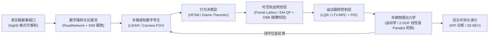

# 面向智能车辆行为决策与路径规划的数字建模及仿真系统
### Digital Modeling and Simulation System for Intelligent Vehicle Behavior Decision-Making and Path Planning

[](https://www.python.org/downloads/)
[](https://opensource.org/licenses/MIT)
[](http://www.siac.net.cn/)
[]()

> 本项目为**中国仿真创新应用大赛**参赛项目研发框架。针对智能车辆在复杂高动态、强交互道路场景下的行为决策与轨迹规划难题，当前版本已构建涵盖**数字道路环境**、**虚拟感知模型**、**规则/博弈分层决策**、**Frenet Lattice + EM/QP 双规划器**、**LQR + MPC 双控制器**、**线性/Pacejka 双轮胎模型**、**IDM/MOBIL 交通演化**、**highD 格式解析/微型切片与 IDM 标定工具链**及**真实 KPI 量化评估**的闭环仿真基线。全量 highD、INTERACTION/NGSIM、城市无保护路口与 OpenSCENARIO/ROS/CARLA 联合仿真仍是后续迭代项，当前实现边界与算法局限见文末。

> 📖 **开发者与 AI 协作规范指南**：本项目提供完备的系统开发与变量口径说明书，请直接参阅 [AI_SYSTEM_SPEC.md](AI_SYSTEM_SPEC.md)。后续人类工程师或 AI 编码工具在进行算法修改、代码生成与扩展时，请严格以该文件作为单一真实数据源（SSOT）。

---

## 目录
- [一、 参赛要求内容映射表](#一-参赛要求内容映射表)
- [二、 系统整体架构与技术路线](#二-系统整体架构与技术路线)
- [三、 核心模块与代码接口组织](#三-核心模块与代码接口组织)
- [四、 开发者与 AI 协作规范 (AI_SYSTEM_SPEC)](#四-开发者与-ai-协作规范-ai_system_spec)
- [五、 快速上手与运行指南](#五-快速上手与运行指南)
- [六、 仿真演示与实验对比](#六-仿真演示与实验对比)
- [七、 当前实现边界（避免过度宣称）](#七-当前实现边界避免过度宣称)
- [八、 参考文献与标准规范](#八-参考文献与标准规范)

---

## 一、 参赛要求内容映射表

依据中国仿真创新应用大赛申报规范，本项目已系统化组织完整的技术支撑材料：

| 竞赛评审要求模块 | 对应技术文档 | 对应源码与实现接口 |
| :--- | :--- | :--- |
| **1. 问题来源和数据来源说明** | [docs/01_problem_and_data.md](docs/01_problem_and_data.md) | `src/environment/dataset_loader.py` (highD 格式 CSV 解析器；INTERACTION/NGSIM 仍为接口，未附带数据) |
| **2. 数字模型或系统** | [docs/02_digital_models.md](docs/02_digital_models.md) | `src/vehicle_model/` (运动学/二自由度线性轮胎), `src/decision/`, `src/planning/` |
| **3. 结果演示分析或说明** | [docs/03_results_and_demo.md](docs/03_results_and_demo.md) | `src/evaluation/metrics.py`, `src/visualization/` (2D BEV 实时动画与 KPI 报告) |
| **4. 应用说明与工程落地** | [docs/04_application.md](docs/04_application.md) | `src/simulator.py` (SIL/MIL 闭环、教学实验；ROS/CARLA 为路线图) |
| **5. 代码体系与参考文献** | [docs/05_references.md](docs/05_references.md) | 完整 Python 代码库规范、单元测试与权威国内外学术专著、ISO 26262/21448 标准 |

---

## 二、 系统整体架构与技术路线

本仿真系统采用分层松耦合、闭环强反馈的现代软件工程架构：



---

## 三、 核心模块与代码接口组织

系统所有功能模块均提供完备的 Python 抽象基类与工业级类型提示（Type Hints）：

```
intelligent-vehicle-simulation/
├── AI_SYSTEM_SPEC.md           # 核心系统规范：坐标系基准、变量命名字典与 AI 协作修改守则
├── README.md                   # 项目综合介绍与快速指南
├── configs/                    # 仿真参数与典型场景配置 YAML
│   ├── default_config.yaml     # 车辆物理参数、感知视场、仿真步长
│   └── scenarios/              # 高速汇入、城市路口、紧急避撞场景定义
├── docs/                       # 01-05 比赛五段式 + 06 QP/MPC/EM/Pacejka 技术说明
├── src/                        # 核心仿真引擎与算法接口
│   ├── common/                 # 车辆状态、Frenet 映射、OBB-SAT 碰撞、纯 NumPy QP 求解器
│   ├── environment/            # 道路网络、场景加载、IDM/MOBIL 交通演化、highD CSV 解析与 IDM 标定
│   ├── vehicle_model/          # 运动学、2-DOF 动力学（线性/Pacejka 可切换）、传感器模型
│   ├── decision/               # 分层有限状态机 (HFSM) 与博弈交互决策器接口
│   ├── planning/               # Frenet Lattice 采样 + EM 路径/速度 QP + 碰撞校验
│   ├── control/                # LQR / LTV-MPC 横向跟踪 + 曲率前馈 + 纵向 PID
│   ├── evaluation/             # 安全性、舒适性、控制精度与实时算力 KPI 评估体系
│   ├── visualization/          # 2D 鸟瞰图 (BEV) 实时动态渲染器与科研级高清图表导出
│   ├── runner.py               # 场景 -> 决策/规划/控制/引擎的统一装配工厂
│   └── simulator.py            # 端到端闭环仿真控制主引擎 (SimulationEngine)
├── scripts/                    # 运行脚本
│   ├── run_simulation.py       # 单场景交互式可视化仿真入口
│   ├── run_benchmark.py        # 批量基准场景自动化评测脚本
│   └── export_results.py       # 竞赛图表与对比数据一键导出工具
├── tests/                      # 单元测试与接口集成测试
└── requirements.txt            # 项目依赖
```

---

## 四、 开发者与 AI 协作规范 (AI_SYSTEM_SPEC)

为了确保后续人类开发者与各 AI 辅助工具（Cursor, Copilot, Gemini, Claude）协同开发时不发生命名冲突或物理量纲偏差，系统统一确立了以下开发守则（详见 [AI_SYSTEM_SPEC.md](AI_SYSTEM_SPEC.md)）：

1. **统一物理量纲 (SI Units)**：所有时间统一为秒（$\text{s}$），距离与坐标为米（$\text{m}$），速度为米/秒（$\text{m/s}$），加速度为 $\text{m/s}^2$，角度一律采用弧度（$\text{rad}$）；
2. **标准车辆坐标系 (ISO 8855)**：X 轴前向为正，Y 轴左侧为正，Z 轴天向为正，逆时针转动为正；
3. **道路 Frenet 映射**：纵向沿参考线为 $s$（前进为正），横向偏离为 $l$（左正右负）；
4. **严格接口契约**：新增规划器必须继承 `BasePlanner`，新增决策器继承 `BaseDecisionMaker`，新增控制器继承 `BaseController`；
5. **场景统一加载**：路网、自车与障碍物必须通过 `src/environment/scenario_loader.py` 进入仿真，禁止在脚本中再硬编码一套与 YAML 不一致的世界。

---

## 五、 快速上手与运行指南

### 1. 环境准备
建议在 Python 3.9+ 虚拟环境中运行：
```bash
# 安装核心依赖
pip install -r requirements.txt
```

### 2. 运行交互式仿真演示
执行高速汇入场景闭环仿真（带 2D BEV 实时可视化与仪表 HUD）：
```bash
# 使用内置 highway_merge 场景（无 PyYAML 也可运行）
python3 scripts/run_simulation.py --scenario highway_merge --decision fsm --duration 20 --no_vis

# 保存逐帧 telemetry 与 KPI
python3 scripts/run_simulation.py --scenario highway_merge --decision game --duration 20 --no_vis --save_results

# 切换到 EM/QP 规划 + MPC 控制 + Pacejka 轮胎（会强制启用 2-DOF 动力学）
python3 scripts/run_simulation.py --scenario emergency_avoidance --decision fsm \
  --planner em --controller mpc --tire pacejka --duration 10 --no_vis

# 仅切换规划器或控制器做 A/B
python3 scripts/run_simulation.py --scenario highway_merge --planner em --controller lqr --duration 10 --no_vis
```

### 3. 运行自动化单元测试
检验各层算法接口一致性与数值正确性：
```bash
# 低功耗回归：限制 BLAS 线程、降低进程优先级、关闭 .pyc 写入
OMP_NUM_THREADS=1 OPENBLAS_NUM_THREADS=1 VECLIB_MAXIMUM_THREADS=1 MKL_NUM_THREADS=1 \
  nice -n 19 python3 -B -m unittest discover tests -v
```

测试覆盖坐标变换、OBB、运动学/动力学、QP 求解器、LQR/PID、MPC、Frenet Lattice、EM/QP、Pacejka、碰撞指标、highD CSV 解析、微型切片生成、seed 复现、闭环速度跟踪、IDM 障碍物预测、MOBIL/脚本换道、批量评测统计及 IDM 参数辨识。具体测试数量以 `python3 -m unittest discover tests -v` 的实际输出为准。

> 开发期建议只跑上述单元测试（约 3 s）。多 seed `run_benchmark.py`、可视化渲染与图表导出会持续占用 CPU；建议在空闲时段单独运行，并沿用上面的单线程 + `nice` 低功耗命令，避免与日常编码并行导致机器过热。

### 4. 导出竞赛报告高清科研图表
```bash
python3 scripts/export_results.py --scenario highway_merge --decision fsm --duration 20
```

---

## 六、 仿真演示与实验对比

仓库当前没有随附基准原始输出，因此本节不列未经追溯的实验数字。EM/QP、MPC、Pacejka 已通过单元/集成测试与短时 CLI 冒烟，但尚未纳入基准结果表，不能作为性能结论。复现实验命令如下，执行后会写出逐次 JSON/CSV 与分组汇总 CSV：

```bash
python3 scripts/run_benchmark.py --scenarios highway_merge emergency_avoidance cut_in --decisions fsm game --seeds 42 --duration 20
```

---

## 七、 当前实现边界（避免过度宣称）

**已实现并进入闭环：**
- `RoadNetwork` 直线多车道参考线（真实 s / theta / kappa）、按位置查车道；
- Frenet 双向映射、五次多项式 Lattice、按时间投影障碍物的 OBB 碰撞校验；
- IDM 跟驰步进与可由场景配置启用的 MOBIL 协同换道状态机（三次多项式平滑横向过渡）；`cut_in` 使用配置触发的定时平滑横向切入；
- **EM/QP 规划器**：路径 QP（横向偏移平滑 + 障碍物走廊）与速度 QP（S-T 图跟驰/停车 + 终端速度保护），可经 `--planner em` 切换；
- FSM 与收益矩阵博弈决策；
- **LQR 与 LTV-MPC 双控制器**：LQR 为时间索引预瞄 + 曲率前馈；MPC 为误差动力学 + QP 硬/软约束，可经 `--controller mpc` 切换；
- **线性与 Pacejka 双轮胎模型**：2-DOF 动力学可选择稳态魔术公式 + 载荷转移 + 简化摩擦椭圆，可经 `--tire pacejka` 切换；
- 真实 KPI：OBB 碰撞、最小净距、TTC、横向/航向误差、Δa/Δt jerk、规划/决策/控制时延；
- `highway_merge`、`emergency_avoidance`、`cut_in` 三个内置场景、YAML/JSON 场景加载、seed 复现；
- 微型 highD 演示数据生成脚本（`scripts/generate_sample_highd.py`）与系统辨识参数标定工具链（`src/environment/calibration.py`）。

**接口预留 / 尚未完成：**
- INTERACTION / NGSIM 数据集接入（仍为接口预留）；
- 全量实测数据生产环境标定（已提供辨识工具链与微型切片，未附带数十 GB 原始全量数据）；
- 城市无保护路口、OpenSCENARIO / ROS / CARLA 联合仿真；
- 大规模多 seed 统计与置信区间。

**算法局限（必须如实表述）：**
- EM 是“路径 QP + 速度 QP”的工程化路径-速度解耦实现，不是 Apollo EM 的完整迭代 E/M 收敛；障碍物走廊按单侧凸走廊近似，动态障碍物横向预测采用常速度/预测轨迹；
- MPC 采用 Frenet 误差动力学线性化 + QP，不是非线性 NMPC；预测模型不包含 Pacejka 轮胎动力学，QP 失败时回退为曲率前馈 PD + 纵向 P，并在 `last_solve_info` 记录原因；
- Pacejka 为稳态纯侧偏 + 简化摩擦椭圆，不含轮胎松弛长度、温度/胎压与完整试验标定；
- QP 后端为纯 NumPy ADMM，不承诺硬实时；`max_planning_latency_ms` 应在目标机器上实测，不能把平均值当作最坏时延。

这些边界会在 [docs/03_results_and_demo.md](docs/03_results_and_demo.md)、[docs/06_qp_mpc_em_pacejka.md](docs/06_qp_mpc_em_pacejka.md) 与 [AI_SYSTEM_SPEC.md](AI_SYSTEM_SPEC.md) 中同步说明。评审材料中不应把“接口预留”写成“已完成”，也不应把“可切换框架”写成“已完成大规模性能验证”。

---

## 八、 参考文献与标准规范
1. **Werling, M., et al.** (2010). Optimal trajectory generation for dynamic street scenarios in a Frenet Frame. *IEEE ICRA*.
2. **Fan, H., et al.** (2018). Baidu Apollo EM Motion Planner. *arXiv:1807.08048*.
3. **Pacejka, H. B.** (2005). *Tire and vehicle dynamics*. Elsevier.
4. **Krajewski, R., et al.** (2018). The highD dataset. *IEEE ITSC*.
5. **ISO 26262 / ISO 21448 (SOTIF)** 汽车功能安全与预期功能安全国际标准规范.
