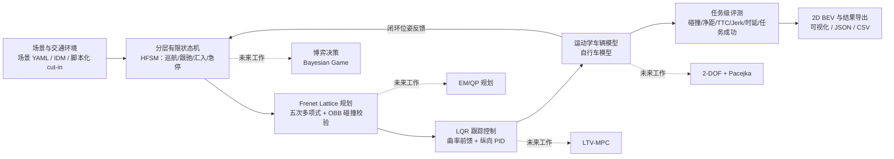

# 面向智能车辆行为决策与路径规划的数字建模及仿真系统
### Digital Modeling and Simulation System for Intelligent Vehicle Behavior Decision-Making and Path Planning

[](https://www.python.org/downloads/)
[](LICENSE)
[](http://www.siac.net.cn/)
[](https://github.com/fwwwwjj/intelligent-vehicle-simulation/actions/workflows/ci.yml)

> 本地测试：96 项通过（`python -m unittest discover tests`）；CI 是否通过以 GitHub Actions 徽标/页面为准，不使用静态“tests passing”徽标。
>
> 本项目为**中国仿真创新应用大赛**参赛项目。当前版本（v0.4-core）聚焦一条**可运行、可验证、可复现**的闭环主链：
>
> **IDM/脚本化交通环境 → 分层有限状态机（HFSM）→ Frenet Lattice 轨迹规划 → LQR 横向/纵向控制 → 运动学车辆模型 → 任务级 KPI**，并在规划轨迹 invalid 时进入最小风险制动。
>
> 覆盖 `highway_merge`、`cut_in`、`emergency_avoidance` 三个核心场景。
>
> 博弈决策、EM/QP、LTV-MPC、Pacejka 轮胎、城市无保护路口、全量 highD 标定、OpenSCENARIO/ROS/CARLA 联仿属于**未来工作/探索性模块**：代码与接口保留，但不纳入当前主结果。范围说明见 [docs/07_scope_and_future_work.md](docs/07_scope_and_future_work.md)。

> 📖 **开发者与 AI 协作规范**：坐标系、变量口径、接口契约与验收标准见 [AI_SYSTEM_SPEC.md](AI_SYSTEM_SPEC.md)。

---

## 目录

- [一、 参赛要求内容映射表](#一-参赛要求内容映射表)
- [二、 系统整体架构](#二-系统整体架构)
- [三、 核心模块与代码组织](#三-核心模块与代码组织)
- [四、 当前核心范围与未来工作](#四-当前核心范围与未来工作)
- [五、 快速上手](#五-快速上手)
- [六、 核心结果](#六-核心结果)
- [七、 当前实现边界](#七-当前实现边界)
- [八、 未来工作](#八-未来工作)
- [九、 参考文献](#九-参考文献)

---

## 一、 参赛要求内容映射表

| 竞赛评审要求模块 | 对应技术文档 | 对应源码与实现接口 |
| :--- | :--- | :--- |
| **1. 问题来源和数据来源说明** | [docs/01_problem_and_data.md](docs/01_problem_and_data.md) | `src/environment/scenario_loader.py`（YAML/JSON/内置场景）；`dataset_loader.py`（highD 格式解析器） |
| **2. 数字模型或系统** | [docs/02_digital_models.md](docs/02_digital_models.md) | `src/vehicle_model/`（运动学）、`src/decision/`（FSM）、`src/planning/`（Lattice）、`src/control/`（LQR/PID） |
| **3. 结果演示分析或说明** | [docs/03_results_and_demo.md](docs/03_results_and_demo.md) | `src/evaluation/metrics.py`、`src/visualization/`、`results/`（JSON/CSV/KPI） |
| **4. 应用说明与工程落地** | [docs/04_application.md](docs/04_application.md) | `src/simulator.py`（MIL/SIL 闭环、教学实验） |
| **5. 代码体系与参考文献** | [docs/05_references.md](docs/05_references.md) | Python 代码库、96 项本地测试、标准与文献列表 |

> 复杂算法（Game/EM/MPC/Pacejka/交叉口）的说明保留在 [docs/06_qp_mpc_em_pacejka.md](docs/06_qp_mpc_em_pacejka.md)，并在 [docs/07_scope_and_future_work.md](docs/07_scope_and_future_work.md) 中明确标为未来工作。

---

## 二、 系统整体架构

当前核心链路（实线）与未来工作（虚线）：



---

## 三、 核心模块与代码组织

```
intelligent-vehicle-simulation/
├── README.md                   # 项目总览（当前核心 + 未来工作）
├── AI_SYSTEM_SPEC.md           # SSOT：坐标系、变量口径、接口契约、验收口径
├── configs/
│   ├── default_config.yaml     # 车辆物理参数、感知、仿真步长
│   └── scenarios/              # 三个核心场景 + 一个实验性交叉口
├── docs/
│   ├── 01_problem_and_data.md  # 问题与数据来源
│   ├── 02_digital_models.md    # 数字模型（核心/未来工作标注）
│   ├── 03_results_and_demo.md  # 核心 30-seed 结果与分析
│   ├── 04_application.md       # 应用与工程落地
│   ├── 05_references.md        # 代码体系与参考文献
│   ├── 06_qp_mpc_em_pacejka.md # 未来工作技术储备
│   ├── 07_scope_and_future_work.md  # 当前范围与未来工作清单
│   ├── 08_paper_draft.md       # 论文草稿（v0.4-core）
│   ├── 09_slides_and_video_outline.md  # 答辩 PPT/视频大纲
│   └── 10_highd_calibration_replay.md  # highD 最小可信版
├── src/
│   ├── common/                 # 状态、Frenet、OBB-SAT、QP 后端
│   ├── environment/            # 路网、场景加载、IDM/MOBIL、highD 解析、标定
│   ├── vehicle_model/          # 运动学、2-DOF（线性/Pacejka）、传感器
│   ├── decision/               # FSM（核心）、Game（探索性）
│   ├── planning/               # Lattice（核心）、EM/QP（探索性）
│   ├── control/                # LQR/PID（核心）、MPC（探索性）
│   ├── evaluation/             # 任务级 KPI、批量 benchmark
│   ├── visualization/          # 2D BEV、科研图表
│   ├── runner.py               # 场景 → 算法装配工厂
│   └── simulator.py            # 闭环仿真主引擎
├── scripts/                    # run_simulation / run_benchmark / batches / export_* / highD 标定回放
├── tests/                      # 96 项单元/闭环测试
└── results/                    # 30-seed 核心基准 JSON/CSV、归档
```

> 标注“探索性/未来工作”的模块不是删除，而是**不纳入当前论文/答辩主结果**；接口、单元测试和 CLI 开关保留，方便后续继续做。

---

## 四、 当前核心范围与未来工作

### 4.1 核心（纳入主结果）

| 模块 | 实现 | 说明 |
| :--- | :--- | :--- |
| 决策 | `rule_based_fsm.py` | 巡航 / 跟驰 / 汇入 / 紧急停车 |
| 规划 | `frenet_lattice.py` | 五次多项式 + 真实参考线 + OBB 碰撞校验 |
| 控制 | `lqr_controller.py` + `pid_controller.py` | 曲率前馈 + 时间索引预瞄 + 纵向 PID |
| 车辆 | `kinematics.py` | 运动学自行车模型 |
| 环境 | `obstacle_manager.py` | IDM 跟驰 + 脚本化 cut-in |
| 安全监督 | `simulator.py` | 记录 `planner_invalid`；若 invalid 轨迹在 1 s 内即将碰撞，则进入最小风险制动并记录 `safety_brake` |
| 评测 | `simulator.py` + `metrics.py` | 碰撞/净距/TTC/Jerk/横向误差/时延/任务成功 |
| 场景 | 3 个 | `highway_merge`、`cut_in`、`emergency_avoidance` |

### 4.2 未来工作（代码保留，不纳入主结果）

| 模块 | 当前状态 | 未来工作 |
| :--- | :--- | :--- |
| 博弈决策 | 收益评估/信念更新原型；高速汇入 20 s 内未完成汇入 | 修复汇入死锁；形式化博弈；30+ seeds 对比 |
| EM/QP | 路径 QP + 速度 QP 原型 | 与 Lattice 公平对比；时延/回退统计 |
| LTV-MPC | 线性化误差模型 + QP；紧急制动会撞车 | 修 emergency stop；与 LQR 对比 |
| Pacejka | 稳态魔术公式原型 | 轮胎试验标定；与线性轮胎对比 |
| 城市无保护路口 | 拓扑存在；车辆会驶出道路 | 局部 Frenet、冲突点/路权、曲率限速 |
| highD 真实标定 | highD 格式解析 + 最小可信版脚本已就绪，真实 recording 结果待补 | 下载真实 recording 运行脚本；全量生产标定仍未来工作 |
| OpenSCENARIO/ROS/CARLA | 占位/路线图 | 后续工程化 |

> 论文/答辩中请使用“未来工作/探索性原型”的表述，不要写成“已完成并验证”。

---

## 五、 快速上手

### 1. 环境准备

```bash
python3 -m venv .venv
source .venv/bin/activate
pip install -r requirements.txt
```

核心计算只需要 NumPy；PyYAML、Matplotlib、SciPy 分别用于 YAML 场景、可视化和 LQR 求解（缺失时 LQR 会回退到 numpy Riccati 迭代）。

### 2. 运行核心场景

```bash
# 高速汇入（无图形界面）
python3 scripts/run_simulation.py --scenario highway_merge --decision fsm --duration 20 --no_vis

# 邻道 cut-in
python3 scripts/run_simulation.py --scenario cut_in --decision fsm --duration 20 --no_vis

# 前方静止车紧急制动
python3 scripts/run_simulation.py --scenario emergency_avoidance --decision fsm --duration 20 --no_vis
```

保存逐帧 telemetry 与 KPI：

```bash
python3 scripts/run_simulation.py --scenario highway_merge --decision fsm \
  --duration 20 --no_vis --save_results
```

### 3. 运行测试（低功耗）

```bash
OMP_NUM_THREADS=1 OPENBLAS_NUM_THREADS=1 VECLIB_MAXIMUM_THREADS=1 MKL_NUM_THREADS=1 \
  nice -n 19 python3 -B -m unittest discover tests -v
```

当前 **96 项测试**，约 10–20 s（含任务级闭环用例，视机器负载）。测试覆盖坐标变换、OBB、运动学/动力学、QP、LQR/PID、MPC、Lattice、EM、Pacejka、指标、highD 解析、标定、闭环速度跟踪、seed 复现、任务成功判据。

### 4. 运行核心基准（低功耗，30 seeds）

```bash
OMP_NUM_THREADS=1 OPENBLAS_NUM_THREADS=1 VECLIB_MAXIMUM_THREADS=1 MKL_NUM_THREADS=1 \
  nice -n 19 python3 -B scripts/run_benchmark.py \
  --scenarios highway_merge cut_in emergency_avoidance \
  --decisions fsm \
  --seeds 42 43 44 45 46 47 48 49 50 51 52 53 54 55 56 57 58 59 60 61 62 63 64 65 66 67 68 69 70 71 \
  --duration 20.0
```

输出 `results/benchmark.json`、`results/benchmark.csv`、`results/benchmark_summary.csv`。

分批补 seeds（批间休眠，避免持续发热）：

```bash
python3 scripts/run_benchmark_batches.py \
  --seeds 52 53 54 55 56 57 58 59 60 61 \
  --batch-size 5 --duration 20 --sleep 45
```

### 5. 生成核心图表

```bash
python3 scripts/export_core_figures.py --seed 42 --duration 20 \
  --output-dir results/competition_pack/figures
```

输出 3 张 BEV、1 张三场景遥测图和 1 张 30-seed KPI 箱线图。

> 30 seeds 是轻量基准；论文目标为每条件 30–50 seeds。建议分批运行，保持单线程 BLAS + `nice`，避免机器持续高负载。

### 6. highD 最小可信版（需真实数据）

把 highD recording 放到 `data/raw/highD/` 后：

```bash
# IDM 跟驰参数标定
python3 scripts/calibrate_highd.py --data-root data/raw/highD --recording 01

# 开环轨迹回放（BEV 截图 + JSON，可选 GIF）
python3 scripts/replay_highd.py --data-root data/raw/highD --recording 01 \
  --start-time 0 --duration 10 --step 0.5 --max-frames 12 --gif
```

当前状态：**highD 格式解析 + 最小可信版脚本已就绪，真实 recording 结果待补**。这是**最小可信版**：只做同车道跟驰标定 + 开环回放，不做闭环交互。`data/sample_highd` 是合成样例，输出会标记 `synthetic_sample`，不能写成真实标定。详见 [docs/10_highd_calibration_replay.md](docs/10_highd_calibration_replay.md)。

---

## 六、 核心结果

环境：Python 3.9.6，Apple Silicon，单线程 BLAS，`nice -n 19`；每组 30 seeds，20 s 闭环。

| 场景 | 任务成功率 (95% CI) | 最小净距 (m) | 最小 TTC (s) | RMS Jerk (m/s³) | 最大横向误差 (m) | 规划均值 / p95 (ms) |
| :--- | :---: | :---: | :---: | :---: | :---: | :---: |
| `highway_merge` | 1.000 [0.886, 1.000] | 1.84 ± 0.01 | 20.41 ± 0.12 | 2.003 ± 0.021 | 0.060 ± 0.000 | 2.29 / 3.15 |
| `cut_in` | 1.000 [0.886, 1.000] | 5.47 ± 0.16 | 1.75 ± 0.04 | 1.833 ± 0.038 | 0.074 ± 0.003 | 1.99 / 5.06 |
| `emergency_avoidance` | 1.000 [0.886, 1.000] | 14.11 ± 0.13 | 2.37 ± 0.00 | 1.803 ± 0.002 | 0.000 ± 0.000 | 1.56 / 1.89 |

> 任务成功率 = 完成任务 + 无碰撞 + 不驶出道路，不是“未碰撞”。详细定义、逐 seed 结果与复现命令见 [docs/03_results_and_demo.md](docs/03_results_and_demo.md) 和 `results/`。
>
> **关于 cut-in 的 TTC：** 最小 TTC 约 **1.75 s**，低于常用的 2.7 s 预警阈值，说明该脚本化切入是**紧安全余量**工况；其最小净距约 5.47 m、最大制动约 5.94 m/s²、无碰撞。详细解释见 docs/03 §3.3，不能把它写成“安全余量充足”。
> 图表见 `results/competition_pack/figures/`；论文草稿见 [docs/08_paper_draft.md](docs/08_paper_draft.md)；答辩/视频大纲见 [docs/09_slides_and_video_outline.md](docs/09_slides_and_video_outline.md)。

---

## 七、 当前实现边界

**仿真保真度（重要）：** 核心使用**运动学自行车模型**，不含轮胎侧滑、载荷转移、悬架/制动动力学，也没有传感器/执行器硬件延迟。因此它是“决策—规划—控制逻辑 + 任务级 KPI”的仿真基线，**不是高保真车辆动力学仿真，也不是 HIL**。本文的横向加速度、舒适性和安全间距结论都是模型级结论，不能外推为真实车辆极限；2-DOF + Pacejka 属于未来工作。

**已进入核心闭环：**

- 数字路网、Frenet 双向映射、真实 `s/theta/kappa` 参考线；
- 分层 FSM：巡航、跟驰、汇入、紧急停车；
- Frenet Lattice：五次多项式、真实参考线、按时间投影障碍物的 OBB 碰撞校验；
- LQR 横向跟踪 + 曲率前馈 + 纵向 PID；横向加速度限制在 2.5 m/s² 附近；
- IDM 跟驰与脚本化 cut-in；
- 任务级 KPI：碰撞、净距、TTC、Jerk、横向/航向误差、决策/规划/控制时延、任务成功/完成时间/驶出道路；
- 三个核心场景、YAML/JSON/内置场景加载、seed 复现；
- 30-seed 基准与 JSON/CSV 结果。

**未来工作（不纳入当前主结果）：**

- 代码保留、接口可用，但 CLI 默认**拒绝**直接进入主结果：`--decision game`、`--planner em`、`--controller mpc`、`--tire pacejka` 或交叉口场景必须显式加 `--allow-experimental`；批量评测会写 `experimental=true` 与 `experimental_reasons`。

- 博弈决策（Game）——当前高速汇入会长时间礼让，20 s 内未汇入；
- EM/QP 规划、LTV-MPC、Pacejka 轮胎；
- 城市无保护路口——当前会驶出道路；
- 真实 highD recording 运行、全量生产标定、INTERACTION/NGSIM；
- OpenSCENARIO/ROS/CARLA 联合仿真；
- 30–50 seeds 统计、参数扰动、SOTIF 边界场景。

**不能写的表述：**

- “Game 比 FSM 舒适性提升 50.4%”（当前 Game 未完成汇入，不可比）；
- “EM/QP、MPC、Pacejka 已完成多 seed 验证”；
- “城市无保护左转已实现”；
- “基于 highD 真实数据标定”；
- “统计显著优于基线”。

---

## 八、 未来工作

1. **博弈决策**：修复 Game 汇入死锁；形式化 players/actions/payoffs；加 liveness/最大等待时间；30+ seeds 与 FSM 对比。
2. **EM/QP**：与 Lattice 做公平对比；统计规划时延、回退率、约束违反。
3. **LTV-MPC**：修复 emergency stop；加终端约束/更长时域；与 LQR 对比。
4. **Pacejka**：轮胎试验标定；与线性轮胎对比。
5. **城市无保护路口**：局部 Frenet 车道查询、冲突点/路权、曲率限速。
6. **真实数据**：highD 子集标定/回放；INTERACTION/NGSIM 接入。
7. **联合仿真**：OpenSCENARIO/ROS/CARLA。
8. **大规模统计**：30–50 seeds、参数扰动、SOTIF 边界场景。

详见 [docs/07_scope_and_future_work.md](docs/07_scope_and_future_work.md)。

---

## 九、 参考文献

1. **Werling, M., et al.** (2010). Optimal trajectory generation for dynamic street scenarios in a Frenet Frame. *IEEE ICRA*.
2. **Treiber, M., Hennecke, A., & Helbing, D.** (2000). Congested traffic states in empirical observations and microscopic simulations. *Physical Review E*.
3. **Rajamani, R.** (2011). *Vehicle dynamics and control*. Springer.
4. **Krajewski, R., et al.** (2018). The highD dataset. *IEEE ITSC*.
5. **ISO 26262 / ISO 21448 (SOTIF)** 汽车功能安全与预期功能安全标准.
