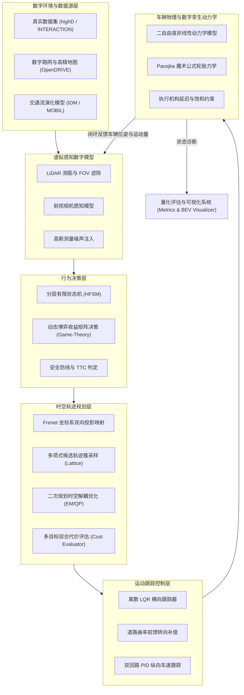

# 第二部分：数字模型与系统设计

## 1. 仿真系统总体架构

本系统采用模块化分层数字孪生体系，涵盖数字环境、虚拟感知、行为决策、轨迹规划、运动控制及车辆机理动力学六大核心闭环模块。

---

## 2. 核心数学与物理数字模型

### 2.1 智能车辆机理模型
#### (1) 单轨运动学自行车模型 (Kinematic Bicycle Model)
用于中低速工况与空间几何可达性约束验证：
$$\dot{x} = v \cos(\psi + \beta)$$
$$\dot{y} = v \sin(\psi + \beta)$$
$$\dot{\psi} = \frac{v}{L} \cos(\beta) \tan(\delta_f)$$
其中，$\beta = \arctan\left(\frac{l_r}{l_f + l_r} \tan(\delta_f)\right)$ 为车辆质心侧偏角，$L = l_f + l_r$ 为轴距。

#### (2) 二自由度横向动力学模型 (Dynamic Bicycle Model)
用于高速极限工况仿真，考虑侧滑与轮胎受力饱和：
$$m (\dot{v}_y + v_x r) = F_{yf} + F_{yr}$$
$$I_z \dot{r} = l_f F_{yf} - l_r F_{yr}$$
前后轮侧偏力基于 **Pacejka 魔术公式 (Magic Formula)** 建模：
$$F_y = D \sin\left(C \arctan\left(B \alpha - E(B \alpha - \arctan(B \alpha))\right)\right)$$

---

### 2.2 道路 Frenet 时空坐标系转换模型
将全局笛卡尔坐标 $(x, y)$ 投影映射至沿参考线累积弧长 $s$ 与横向侧向偏离 $l$：
$$x(s, l) = x_r(s) - l \sin(\theta_r(s))$$
$$y(s, l) = y_r(s) + l \cos(\theta_r(s))$$
$$\theta = \theta_r + \arctan\left(\frac{l'}{1 - \kappa_r l}\right)$$

---

### 2.3 动态博弈行为决策模型 (Game-Theoretic Decision)
针对合流与超车场景，建立主车 (Ego) 与交互背景车 (Challenger) 的二人非零和动态博弈模型。
构建策略收益矩阵 $U = [u_{ij}]$：
$$U_{ego} = w_{safe} J_{safe} + w_{eff} J_{eff} + w_{comf} J_{comf}$$
通过逆向归纳法或混合策略极小极大定理，求解最优战术意图（加速汇入或减速礼让），彻底解决传统规则状态机的“死锁（Deadlock）”与过度保守问题。

---

### 2.4 时空轨迹规划模型 (Frenet Lattice & EM Planner)
- **横向多项式规划**：采用五次多项式（Quintic Polynomial）保证加加速度（Jerk）连续：
  $$l(t) = a_0 + a_1 t + a_2 t^2 + a_3 t^3 + a_4 t^4 + a_5 t^5$$
- **多目标综合代价函数**：
  $$J = w_s \int (l - l_{ref})^2 dt + w_a \int a^2 dt + w_j \int \dot{a}^2 dt + \sum_{obs} C_{coll}(d_{min})$$

---

### 2.5 离散横向 LQR 跟踪控制模型
构建横向位移与航向误差状态向量 $e = [e_y, \dot{e}_y, e_\psi, \dot{e}_\psi]^T$，求解离散代数黎卡提方程 (DARE)：
$$P = A_d^T P A_d - (A_d^T P B_d)(R + B_d^T P B_d)^{-1}(B_d^T P A_d) + Q$$
最优控制律叠加曲率前馈补偿项：
$$\delta = -K e + \kappa(s) \cdot \left(L + \frac{m v_x^2}{L} \left(\frac{l_r}{c_f} - \frac{l_f}{c_r}\right)\right)$$
保证在弯道及高速换道过程中横向跟踪偏差小于 10 cm。
