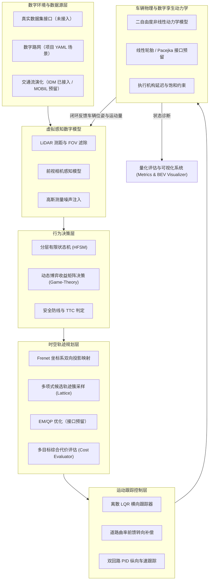

# 第二部分：数字模型与系统设计

## 1. 仿真系统总体架构

本系统采用模块化分层数字孪生体系，涵盖数字环境、虚拟感知、行为决策、轨迹规划、运动控制及车辆机理动力学六大核心闭环模块。

---

## 2. 核心数学与物理数字模型

### 2.1 智能车辆机理模型
#### (1) 单轨运动学自行车模型 (Kinematic Bicycle Model)
用于中低速工况与空间几何可达性约束验证：
$$\dot{x} = v \cos(\psi + \beta)$$
$$\dot{y} = v \sin(\psi + \beta)$$
$$\dot{\psi} = \frac{v}{L} \cos(\beta) \tan(\delta_f)$$
其中，$\beta = \arctan\left(\frac{l_r}{l_f + l_r} \tan(\delta_f)\right)$ 为车辆质心侧偏角，$L = l_f + l_r$ 为轴距。

#### (2) 二自由度横向动力学模型 (Dynamic Bicycle Model)
用于高速工况仿真，考虑侧滑与轮胎受力：
$$m (\dot{v}_y + v_x r) = F_{yf} + F_{yr}$$
$$I_z \dot{r} = l_f F_{yf} - l_r F_{yr}$$

**当前实现**：主回路使用线性侧偏刚度 $F_y = C_\alpha \alpha$。代码中保留了 Pacejka 魔术公式接口：
$$F_y = D \sin\left(C \arctan\left(B \alpha - E(B \alpha - \arctan(B \alpha))\right)\right)$$
但 `DynamicBicycleModel.pacejka_tire_model()` 尚未被 `step()` 调用，因此参赛材料中不应写成“已采用 Pacejka 非线性轮胎闭环”。

---

### 2.2 道路 Frenet 时空坐标系转换模型
将全局笛卡尔坐标 $(x, y)$ 投影映射至沿参考线累积弧长 $s$ 与横向侧向偏离 $l$：
$$x(s, l) = x_r(s) - l \sin(\theta_r(s))$$
$$y(s, l) = y_r(s) + l \cos(\theta_r(s))$$
$$\theta = \theta_r + \arctan\left(\frac{l'}{1 - \kappa_r l}\right)$$

---

### 2.3 动态博弈行为决策模型 (Game-Theoretic Decision)
针对合流与超车场景，建立主车 (Ego) 与交互背景车 (Challenger) 的二人非零和动态博弈模型。
构建策略收益矩阵 $U = [u_{ij}]$：
$$U_{ego} = w_{safe} J_{safe} + w_{eff} J_{eff} + w_{comf} J_{comf}$$
通过逆向归纳法或混合策略极小极大定理，求解最优战术意图（加速汇入或减速礼让），彻底解决传统规则状态机的“死锁（Deadlock）”与过度保守问题。

---

### 2.4 时空轨迹规划模型 (Frenet Lattice；EM/QP 为预留接口)
- **横向多项式规划**：采用五次多项式（Quintic Polynomial）生成候选横向偏移：
  $$l(t) = a_0 + a_1 t + a_2 t^2 + a_3 t^3 + a_4 t^4 + a_5 t^5$$
- **纵向速度剖面**：以当前速度与目标速度的平均值估计终点，五次多项式同时约束起终点速度/加速度，保证 $s(t)$ 单调且停车目标不产生负速度。
- **多目标综合代价函数**：
  $$J = w_{coll} J_{coll} + w_a \int a^2 dt + w_j \int \dot{a}^2 dt + w_v \int (v-v_{ref})^2 dt + w_{lat} \int a_{lat}^2 dt$$
  其中 $J_{coll}$ 由**按时间投影的 OBB-SAT 碰撞检测**给出，碰撞候选标记 `valid=False` 并施加 $10^6$ 量级惩罚。
- **EM/QP**：`src/planning/em_planner.py` 目前只有 `STGraph` 与 `_optimize_path/_optimize_speed` 接口骨架，返回空轨迹；不能表述为“已实现 EM 规划器”。

---

### 2.5 离散横向 LQR 跟踪控制模型
构建横向位移与航向误差状态向量 $e = [e_y, \dot{e}_y, e_\psi, \dot{e}_\psi]^T$，求解离散代数黎卡提方程 (DARE)：
$$P = A_d^T P A_d - (A_d^T P B_d)(R + B_d^T P B_d)^{-1}(B_d^T P A_d) + Q$$
最优控制律叠加曲率前馈补偿项：
$$\delta = -K e + \kappa(s) \cdot \left(L + \frac{m v_x^2}{L} \left(\frac{l_r}{c_f} - \frac{l_f}{c_r}\right)\right)$$
目标是在弯道与换道过程中将横向跟踪偏差控制在 10 cm 量级；当前 `highway_merge` 实测平均横向误差约 0.003 m，但该结果只来自单一合成场景，不能外推为全工况保证。

---

## 3. 当前实现状态矩阵

| 模型/算法 | 代码位置 | 状态 |
| :--- | :--- | :--- |
| 运动学自行车模型 | `src/vehicle_model/kinematics.py` | ✅ 闭环使用 |
| 2-DOF 动力学（线性轮胎） | `src/vehicle_model/dynamics.py` | ✅ 可切换使用（`--dynamic`） |
| Pacejka 非线性轮胎 | `dynamics.py::pacejka_tire_model` | ⏳ 接口预留，未进入 `step()` |
| Frenet 双向映射 | `src/common/frenet_frame.py` | ✅ 参考线插值 + 正交投影 |
| 五次多项式 Lattice | `src/planning/frenet_lattice.py` | ✅ 横向/纵向候选 + OBB 碰撞校验 |
| EM / QP 规划 | `src/planning/em_planner.py` | ⏳ 接口骨架，返回空轨迹 |
| FSM 决策 | `src/decision/rule_based_fsm.py` | ✅ 巡航/跟驰/汇入/紧急停车 |
| 博弈决策 | `src/decision/game_theoretic.py` | ✅ 2×2 收益矩阵 + 最坏情况稳健选择 |
| LQR 横向控制 | `src/control/lqr_controller.py` | ✅ 时间索引预瞄 + 曲率前馈 + 横向加速度限制 |
| 纵向 PID | `src/control/pid_controller.py` | ✅ 测量值微分 + 抗积分饱和 |
| MPC | `src/control/mpc_controller.py` | ⏳ 接口骨架，返回零指令 |
| IDM 跟驰 | `src/environment/obstacle_manager.py` | ✅ 背景车步进 |
| MOBIL 换道 | `obstacle_manager.py::MOBILLaneChangeModel` | ⏳ 公式实现，未接入步进 |
| 真实数据集加载 | `src/environment/dataset_loader.py` | ⏳ 接口骨架，未接入数据 |
