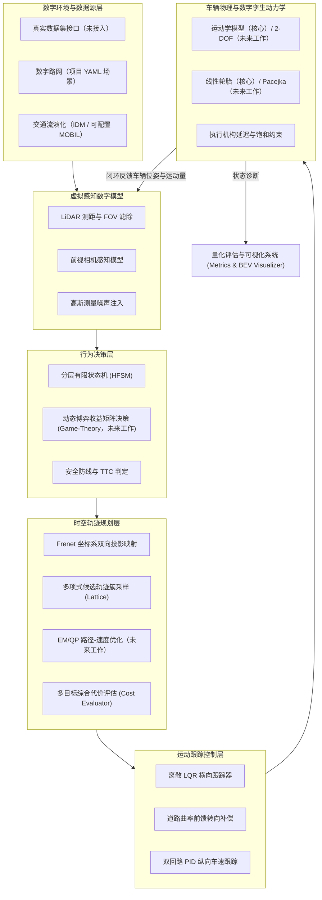

# 第二部分：数字模型与系统设计

> **范围说明（v0.4-core）**：当前核心交付使用 §2.1（运动学）、§2.2（Frenet）、§2.5（LQR）+ Frenet Lattice。§2.3（博弈决策）、§2.4（EM/QP）、§2.6（LTV-MPC）、§2.1 中的 Pacejka 分支属于**未来工作/技术储备**，保留数学说明与代码原型，但不纳入当前论文/答辩主结果。范围清单见 [07_scope_and_future_work.md](07_scope_and_future_work.md)。

## 1. 仿真系统总体架构

本系统采用模块化分层数字孪生体系，涵盖数字环境、虚拟感知、行为决策、轨迹规划、运动控制及车辆机理动力学六大核心闭环模块。

---

## 2. 核心数学与物理数字模型

### 2.1 智能车辆机理模型
#### (1) 单轨运动学自行车模型 (Kinematic Bicycle Model)
用于中低速工况与空间几何可达性约束验证：
$$\dot{x} = v \cos(\psi + \beta)$$
$$\dot{y} = v \sin(\psi + \beta)$$
$$\dot{\psi} = \frac{v}{L} \cos(\beta) \tan(\delta_f)$$
其中，$\beta = \arctan\left(\frac{l_r}{l_f + l_r} \tan(\delta_f)\right)$ 为车辆质心侧偏角，$L = l_f + l_r$ 为轴距。

#### (2) 二自由度横向动力学模型 (Dynamic Bicycle Model)
用于高速工况仿真，考虑侧滑与轮胎受力：
$$m (\dot{v}_y + v_x r) = F_{yf} + F_{yr}$$
$$I_z \dot{r} = l_f F_{yf} - l_r F_{yr}$$

**当前实现**：`DynamicBicycleModel` 支持两种可切换轮胎口径：

- `tire_model="linear"`：$F_y = C_\alpha \alpha$，保持与早期实验一致的线性轮胎；
- `tire_model="pacejka"`：调用 `PacejkaTireModel` 的稳态魔术公式
  $$F_y = D \sin\left(C \arctan\left(B \alpha - E(B \alpha - \arctan(B \alpha))\right)\right),\quad D=\mu F_z D_{scale}$$
  并计入纵向载荷转移与简化摩擦椭圆组合滑移。

Pacejka 分支不含轮胎松弛长度、温度/胎压与完整试验标定，因此应表述为“Pacejka 稳态魔术公式已进入 2-DOF 动力学主回路”，不能写成完整轮胎试验台模型。通过 `--tire pacejka` 可复现该分支。

---

### 2.2 道路 Frenet 时空坐标系转换模型
将全局笛卡尔坐标 $(x, y)$ 投影映射至沿参考线累积弧长 $s$ 与横向侧向偏离 $l$：
$$x(s, l) = x_r(s) - l \sin(\theta_r(s))$$
$$y(s, l) = y_r(s) + l \cos(\theta_r(s))$$
$$\theta = \theta_r + \arctan\left(\frac{l'}{1 - \kappa_r l}\right)$$

---

### 2.3 动态博弈行为决策模型 (Game-Theoretic Decision)

> **未来工作**：当前 `game_theoretic.py` 是探索性原型，在高速汇入中 20 s 内未完成汇入，不纳入主结果。以下公式描述目标设计，不代表已通过验证。
目标设计是主车 (Ego) 与交互背景车 (Challenger) 的期望效用评估：对 3 个自车动作 × 2 个对手动作计算加权效用 $U_{ego} = w_{safe} J_{safe} + w_{eff} J_{eff} + w_{comf} J_{comf}$，再取期望效用最大的动作。

当前实现**没有**求解 Nash 均衡、没有逆向归纳、也没有极小极大定理；对手礼让概率是启发式递推，不是严格贝叶斯后验。因此论文中不能写成“博弈均衡/彻底解决死锁”；这些是未来工作。

---

### 2.4 时空轨迹规划模型 (Frenet Lattice 与 EM/QP 双规划器)

> **核心/未来工作边界**：Frenet Lattice 属于当前核心；EM/QP 属于未来工作，未纳入主结果。
- **横向多项式规划**：采用五次多项式（Quintic Polynomial）生成候选横向偏移：
  $$l(t) = a_0 + a_1 t + a_2 t^2 + a_3 t^3 + a_4 t^4 + a_5 t^5$$
- **纵向速度剖面**：以当前速度与目标速度的平均值估计终点，五次多项式同时约束起终点速度/加速度，保证 $s(t)$ 单调且停车目标不产生负速度。
- **多目标综合代价函数**：
  $$J = w_{coll} J_{coll} + w_a \int a^2 dt + w_j \int \dot{a}^2 dt + w_v \int (v-v_{ref})^2 dt + w_{lat} \int a_{lat}^2 dt$$
  其中 $J_{coll}$ 由**按时间投影的 OBB-SAT 碰撞检测**给出，碰撞候选标记 `valid=False` 并施加 $10^6$ 量级惩罚。
- **EM/QP 规划器**：`src/planning/em_planner.py` 实现路径 QP 与速度 QP 的路径-速度解耦：
  - 路径层：在固定站距 $s_i$ 上优化 $l(s)$，代价含横向偏移、斜率、曲率、三阶平滑与起点斜率，约束为道路边界、起点位姿与障碍物单侧凸走廊（带松弛）；
  - 速度层：在时间网格上优化 $v(t)$，约束为速度/加速度/加加速度边界与 S-T 图跟驰/停车上界；S-T 上界会穿越时增加终端速度保护，避免“时域末端贴住障碍物但末端速度仍很高”的 horizon 截断漏洞；
  - 失败回退：路径 QP 失败退化为 smoothstep 横移插值，速度 QP 失败退化为带制动距离约束的保守速度剖面，二者仍会做 OBB-SAT 碰撞校验。

  该实现是工程化的路径-速度解耦 QP，不是 Apollo EM 的完整迭代 E/M 收敛；详见 `docs/06_qp_mpc_em_pacejka.md`。

---

### 2.5 离散横向 LQR 跟踪控制模型
构建横向位移与航向误差状态向量 $e = [e_y, \dot{e}_y, e_\psi, \dot{e}_\psi]^T$，求解离散代数黎卡提方程 (DARE)：
$$P = A_d^T P A_d - (A_d^T P B_d)(R + B_d^T P B_d)^{-1}(B_d^T P A_d) + Q$$
最优控制律叠加曲率前馈补偿项：
$$\delta = -K e + \kappa(s) \cdot \left(L + \frac{m v_x^2}{L} \left(\frac{l_r}{c_f} - \frac{l_f}{c_r}\right)\right)$$
跟踪效果需通过当前基准脚本在指定场景、seed 和模型配置下生成并报告；不得沿用缺少可追溯原始输出的历史误差数字，也不能将合成场景结果外推为全工况保证。

### 2.6 LTV-MPC 跟踪控制模型

> **未来工作**：当前 MPC 为探索性原型，`lattice+MPC` 在 `emergency_avoidance` 中仍会碰撞，不纳入主结果。
以规划轨迹为参考，取误差状态 $e=[e_y,e_\psi,e_v]^T$、控制量 $u=[a,\delta]^T$，在每个预测步使用参考速度 $v_{ref,k}$ 与曲率 $\kappa_{ref,k}$ 线性化：
$$
e_{y,k+1}=e_{y,k}+\Delta t\,v_{ref,k}e_{\psi,k},\qquad
e_{\psi,k+1}=e_{\psi,k}+\Delta t\left(\frac{v_{ref,k}}{L}\delta_k-v_{ref,k}\kappa_{ref,k}\right),
$$
$$
e_{v,k+1}=e_{v,k}+\Delta t(a_k-a_{ref,k}).
$$
在预测时域内最小化横向/航向/速度误差、控制量与控制增量，并施加加速度/转角硬边界、jerk/转角速率硬约束与横向软约束（slack）。QP 由 `src/common/qp.py` 的纯 NumPy ADMM 求解；求解失败时回退为曲率前馈 PD + 纵向 P，并在 `last_solve_info` 记录诊断。该 MPC 不是非线性 NMPC，预测模型不包含 Pacejka 轮胎状态。

---

## 3. 当前实现状态矩阵

> 状态口径：**核心** = 进入当前论文/答辩主结果；**探索性/未来工作** = 代码保留、接口可用，但不纳入主结果。

| 模型/算法 | 代码位置 | 状态 |
| :--- | :--- | :--- |
| 运动学自行车模型 | `src/vehicle_model/kinematics.py` | ✅ 核心：闭环使用 |
| Frenet 双向映射 | `src/common/frenet_frame.py` | ✅ 核心：参考线插值 + 正交投影 |
| 五次多项式 Lattice | `src/planning/frenet_lattice.py` | ✅ 核心：横向/纵向候选 + OBB 碰撞校验 |
| FSM 决策 | `src/decision/rule_based_fsm.py` | ✅ 核心：巡航/跟驰/汇入/紧急停车 |
| LQR 横向控制 | `src/control/lqr_controller.py` | ✅ 核心：时间索引预瞄 + 曲率前馈 + 横向加速度限制 |
| 纵向 PID | `src/control/pid_controller.py` | ✅ 核心：测量值微分 + 抗积分饱和 |
| IDM 跟驰与加速度外推 | `src/environment/obstacle_manager.py` | ✅ 核心：背景车步进与预测 |
| MOBIL 换道 | `obstacle_manager.py::ObstacleManager` | ⚠️ 环境增强：已接入高速汇入，未做换道安全性统计 |
| 2-DOF 动力学（线性/Pacejka） | `src/vehicle_model/dynamics.py` | 🧪 未来工作：可切换原型，未纳入主结果 |
| Pacejka 非线性轮胎 | `tire.py` / `dynamics.py` | 🧪 未来工作：稳态魔术公式，未做试验标定 |
| EM / QP 规划 | `src/planning/em_planner.py` | 🧪 未来工作：路径 QP + ST 速度 QP 原型，未做多 seed 统计 |
| 博弈决策 | `src/decision/game_theoretic.py` | 🧪 未来工作：高速汇入 20 s 内未完成汇入，不可与 FSM 直接比较 |
| MPC | `src/control/mpc_controller.py` | 🧪 未来工作：`lattice+MPC` 在紧急制动中仍会碰撞 |
| QP 后端 | `src/common/qp.py` | 🧪 未来工作技术基础：纯 NumPy ADMM，EM/MPC 使用 |
| 真实数据集加载 | `src/environment/dataset_loader.py` | ⚠️ highD 格式 CSV 解析 + 合成微型样例；真实标定待完成 |
| 参数标定工具链 | `src/environment/calibration.py` | ⚠️ 工具链可用；尚未用真实 highD 完成标定 |
| 城市无保护路口 | `scenario_loader.py` / `configs/scenarios/intersection_unprotected.yaml` | ❌ 实验性：当前会驶出道路，不纳入主结果 |
