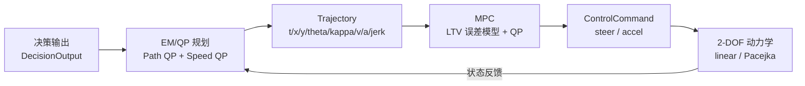

# 第六部分：QP / MPC / EM / Pacejka 主回路技术说明

> 版本：v0.3（2026-10-19）
> 对应代码：`src/common/qp.py`、`src/control/mpc_controller.py`、`src/planning/em_planner.py`、`src/vehicle_model/tire.py`、`src/vehicle_model/dynamics.py`
> 定位：把早期“显式抛错的接口骨架”补齐为**可调用、可切换、可测试、可诊断**的工程框架，同时明确没有做完整 Apollo EM / 非线性 NMPC / 轮胎试验台标定。

---

## 1. 总体数据流



四条主回路均可通过装配层独立切换：

```bash
python3 scripts/run_simulation.py --scenario emergency_avoidance \
  --planner em --controller mpc --tire pacejka --duration 10 --no_vis
```

---

## 2. 通用 QP 后端（`src/common/qp.py`）

### 2.1 标准形式

$$
\min_x \frac12 x^\top P x + q^\top x
\quad \text{s.t.}\quad
l \le A x \le u,\; lb \le x \le ub
$$

盒约束会被展开为 `A` 的单位行，因此 MPC 与 EM 可以共用同一套后端。

### 2.2 ADMM 迭代

引入约束变量 $z$，令 $Ax-z=0$，采用 OSQP 风格的缩放对偶 ADMM：

$$
x^{k+1} = (P+\sigma I+\rho A^\top A)^{-1}
\left(-q+\sigma x^k+\rho A^\top(z^k-y^k)\right)
$$

$$
\tilde z = \alpha A x^{k+1} + (1-\alpha)z^k
$$

$$
z^{k+1} = \operatorname{clip}(\tilde z + y^k,\; l,\; u),\qquad
y^{k+1} = y^k + \tilde z - z^{k+1}
$$

其中 $\alpha=1.6$ 为过松弛系数；$\rho$ 按原始/对偶残差比例自适应调整。

### 2.3 工程约定

- 不强制依赖 OSQP / cvxpy / scipy，纯 NumPy 可运行；
- 支持 `x0/z0/y0` 热启动；
- 返回 `QPSolution`，包含 `success / iterations / primal_residual / dual_residual / objective / constraint_violation / status`；
- 调用方必须检查 `success` 与 `constraint_violation`，不能把未收敛解当作硬约束保证；
- 对偶变量缩放与 slack 变量列缩放用于改善高罚因子问题的条件数。

### 2.4 使用示例

```python
from src.common.qp import solve_qp

# 0.5 x'Px + q'x,  lb <= x <= ub
solution = solve_qp(P, q, lb=lb, ub=ub)
print(solution.x, solution.success, solution.constraint_violation)
```

---

## 3. LTV-MPC 控制器（`src/control/mpc_controller.py`）

### 3.1 误差模型

状态取 $e=[e_y,e_\psi,e_v]^\top$，控制取 $u=[a,\delta]^\top$。以规划轨迹的时间索引参考量为
$v_{ref}(t), \kappa_{ref}(t), a_{ref}(t)$，在预测步 $k$ 处线性化为：

$$
e_{y,k+1}=e_{y,k}+\Delta t\,v_{ref,k}e_{\psi,k}
$$

$$
e_{\psi,k+1}=e_{\psi,k}+\Delta t
\left(\frac{v_{ref,k}}{L}\delta_k-v_{ref,k}\kappa_{ref,k}\right)
$$

$$
e_{v,k+1}=e_{v,k}+\Delta t\,(a_k-a_{ref,k})
$$

曲率前馈转角为 $\delta_{ref}=\arctan(L\kappa_{ref})$。

### 3.2 QP 目标

$$
J=\sum_{k=1}^{N_p}\left(q_y e_{y,k}^2+q_\psi e_{\psi,k}^2+q_v e_{v,k}^2\right)
+\sum_{k=0}^{N_c-1}\left(r_a a_k^2+r_\delta\delta_k^2\right)
+\sum_{k=0}^{N_c-1}\left(r_{\Delta a}\Delta a_k^2+r_{\Delta\delta}\Delta\delta_k^2\right)
+\sum_{k=0}^{N_p-1}\left(w_s s_k^2+w_{s,lin}s_k\right)
$$

其中 $s_k\ge0$ 为横向/航向软约束的松弛变量。

### 3.3 约束

- 加速度、前轮转角硬边界；
- 控制增量（jerk / steering rate）硬约束；
- 横向误差 $|e_y|\le e_{y,max}$ 与可选航向误差软约束；
- 松弛变量非负并施加大罚因子。

### 3.4 失败回退

若 QP 未收敛、解非有限或约束违背超过阈值：

- 转角回退为曲率前馈 + 横向 PD；
- 加速度回退为纵向 P；
- 仍然执行执行机构边界与速率限制；
- `last_solve_info` 保留 `status / success / iterations / residual / violation`，便于定位问题。

MPC 不是非线性 NMPC：预测模型是误差动力学线性化，不包含 Pacejka 轮胎状态。

---

## 4. EM/QP 规划器（`src/planning/em_planner.py`）

### 4.1 路径 QP

在固定站距 $s_i$ 上优化横向偏移 $l_i$（$i=0,\dots,N$）：

$$
\min_l\; w_{ref}\|l-l_{ref}\|^2
+w_1\|D_1l\|^2
+w_2\|D_2l\|^2
+w_3\|D_3l\|^2
+w_{s0}\left(\frac{l_1-l_0}{\Delta s}-l'_0\right)^2
$$

约束：

- 道路边界 $l_{\min}\le l_i\le l_{\max}$；
- 起点位置 $l_0=l_{ego}$；
- 障碍物走廊：对每个障碍物选择左绕或右绕，形成
  $l_i\ge l_{obs}+c$ 或 $l_i\le l_{obs}-c$；
- 走廊约束带松弛变量，避免“两侧都不可行”时 QP 直接崩溃。

若两侧走廊都不可行（例如本车道静止车辆且无横向空间），路径层不做横向绕行，交由速度层停车。

### 4.2 S-T 图与速度 QP

`STGraph` 将障碍物预测轨迹投影为 $(t,s,l)$：

- 只对规划起点时位于自车前方的障碍物生成跟驰/停车约束；
- 横向重叠条件为
  $|l_{obs}-l_{path}(s_{obs})|<\frac12(w_{ego}+w_{obs})+\epsilon$；
- 上界为
  $s_{ego}(t)\le s_{obs}(t)-\frac12(L_{ego}+L_{obs})-s_{safe}$。

速度 QP 变量为 $v_0,\dots,v_{N_t}$，采用梯形积分：

$$
s_k=s_0+\Delta t\left(\frac12v_0+\sum_{j=1}^{k-1}v_j+\frac12v_k\right)
$$

目标：

$$
\min_v\; w_v\|v-v_{ref}\|^2+w_a\|a\|^2+w_j\|j\|^2+w_{term}(v_{N_t}-v_{ref,N_t})^2
$$

约束：

- $0\le v_k\le v_{\max}$，$v_0=v_{ego}$；
- $a_{\min}\le a_k\le a_{\max}$；
- $|j_k|\le j_{\max}$；
- S-T 上界（先硬约束，失败后退回带松弛版本）。

### 4.3 终端速度保护

只在时域内约束 $s(t)\le s_{bound}(t)$ 会留下一个典型漏洞：优化器可以“恰好”在时域末端贴住障碍物边界，但末端速度仍然很高。实现中增加：

- 若 S-T 上界会在时域内被穿越（binding），给终端速度一个保守上界
  $v_{N_t}\le \max(0.5, v_{lead}-0.5)$；
- 同时提高终端速度代价权重；
- 若物理上无法在时域内停住，终端硬上界不启用，由 QP 松弛/回退与控制器兜底。

### 4.4 轨迹缝合与校验

由 $l(s)$ 与 $s(t)$ 生成时空轨迹点，填充
`t/s/x/y/theta/kappa/dkappa/v/a/jerk`，再调用 `TrajectoryCostEvaluator`：

- 按时间投影障碍物并做 OBB-SAT 碰撞检测；
- 检查加速度是否越过物理边界；
- 输出 `Trajectory.valid` 与综合代价。

### 4.5 回退策略

- 路径 QP 失败：退化为从当前横移到目标横移的 smoothstep 插值；
- 速度 QP 失败：按最大加/减速度趋向目标速度，并按
  $v\le\sqrt{2b(s_{bound}-s)}$ 预留制动距离；
- 所有回退路径仍会进入 `TrajectoryCostEvaluator` 做碰撞校验，不会静默返回“看起来有效”的轨迹。

---

## 5. Pacejka 轮胎主回路（`src/vehicle_model/tire.py` / `dynamics.py`）

### 5.1 魔术公式

$$
F_y=D\sin\left(C\arctan\left(B\alpha-E\left(B\alpha-\arctan(B\alpha)\right)\right)\right)
$$

$$
D=\mu F_z D_{scale}
$$

默认参数：$B=10,\ C=1.3,\ D_{scale}=0.95,\ E=-0.97$。

### 5.2 载荷转移

$$
F_{z,f}=m g\frac{l_r}{L}-m a_x\frac{h}{L},\qquad
F_{z,r}=m g\frac{l_f}{L}+m a_x\frac{h}{L}
$$

并限制在静态载荷的 5% 以上，避免数值奇异。

### 5.3 简化摩擦椭圆

纵向力占用附着后，侧向力上限为：

$$
|F_y|\le\sqrt{(\mu F_z)^2-F_x^2}
$$

用于避免“急加速/急制动同时满侧向力”的非物理组合。

### 5.4 与主回路的连接

- `DynamicBicycleModel(tire_model="linear")` 保持原有线性轮胎公式与积分顺序；
- `tire_model="pacejka"` 时前/后轴分别调用 Pacejka 模型；
- `SimulationEngine` 在 `tire_model="pacejka"` 时自动启用 2-DOF 动力学；
- `pacejka_tire_model(slip_angle, fz)` 保留为兼容接口。

Pacejka 分支不包含轮胎松弛长度、温度/胎压、完整组合滑移与试验标定。

---

## 6. 装配与配置

### 6.1 代码入口

| 功能 | 入口 | 切换方式 |
| :--- | :--- | :--- |
| 规划器 | `src/runner.py::build_planner` | `planner="lattice" / "em"` |
| 控制器 | `src/runner.py::build_controller` | `controller="lqr" / "mpc"` |
| 轮胎 | `src/runner.py::build_engine` / `SimulationEngine` | `tire_model="linear" / "pacejka"` |
| QP | `src/common/qp.py::solve_qp` | 纯 NumPy，默认无需额外依赖 |

### 6.2 配置项

`configs/default_config.yaml` 新增：

- `planning.planner` 与 `planning.em.*`；
- `control.controller` 与 `control.mpc.*`；
- `ego_vehicle.tire_model`、`friction_coefficient`、`cg_height`、`pacejka.*`。

CLI 优先级：显式参数 > 场景 YAML/内置配置 > 默认值。

### 6.3 批量评测

`scripts/run_benchmark.py` 新增
`--planner / --controller / --tire / --dynamic`，结果 JSON/CSV 会记录算法字段，便于做
Lattice vs EM、LQR vs MPC、Linear vs Pacejka 的 A/B。

---

## 7. 验证

### 7.1 定向测试（低功耗）

```bash
OMP_NUM_THREADS=1 OPENBLAS_NUM_THREADS=1 VECLIB_MAXIMUM_THREADS=1 \
  nice -n 19 python3 -B -m unittest \
  tests.test_qp_solver tests.test_mpc_controller \
  tests.test_em_planner tests.test_pacejka_tire \
  tests.test_optimized_closed_loop -v
```

### 7.2 冒烟仿真

```bash
OMP_NUM_THREADS=1 OPENBLAS_NUM_THREADS=1 VECLIB_MAXIMUM_THREADS=1 \
  nice -n 19 python3 -B scripts/run_simulation.py \
  --scenario emergency_avoidance --decision fsm \
  --planner em --controller mpc --tire pacejka \
  --duration 5 --no_vis
```

### 7.3 已覆盖的断言

- QP：无约束最优解、盒约束、线性等式/不等式、热启动、不一致边界；
- MPC：空轨迹制动、目标降速、弯道正转角、执行机构/速率限制、短闭环收敛；
- EM：直线速度剖面、静止障碍物终端速度保护、弯道参考线依从、装配入口；
- Pacejka：零侧偏、峰值/饱和、摩擦椭圆、载荷转移、动力学稳定性、线性分支不变；
- 集成：EM+MPC+Pacejka 连续步进、KPI 逐帧记录、`tire_model` 自动切换动力学。

---

## 8. 明确未做 / 不应宣称

- ❌ 完整 Apollo EM 的迭代 E-step/M-step 收敛与多障碍物动态走廊；
- ❌ 非线性 NMPC / 把 Pacejka 状态纳入 MPC 预测模型；
- ❌ 轮胎试验台标定、松弛长度、温度/胎压、完整组合滑移；
- ❌ MOBIL 换道状态机进入 `ObstacleManager.step()`；
- ❌ 硬实时保证；纯 NumPy ADMM 的 `max_planning_latency_ms` 必须在目标机器实测；
- ❌ 大规模多 seed 统计结论；当前结果只做单 seed/短时冒烟。
